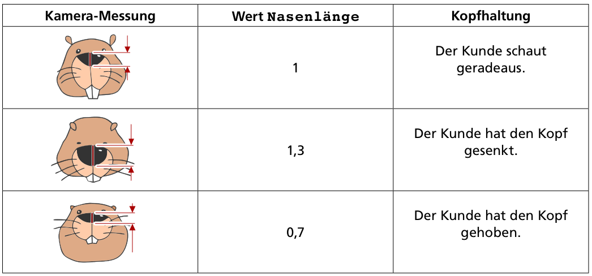

Ein neuer Eintrittskartenautomat soll so funktionieren: Ein Kunde nickt so oft mit dem Kopf – senkt also den Kopf und schaut dann wieder geradeaus – wie viele Karten er kaufen möchte. Danach hebt der Kunde den Kopf, und dann gibt der Automat die Karten aus.

Der Automat hat dazu eine Kamera eingebaut. Sie kann die Nasen der Kunden erkennen und misst ständig die Nasenlänge. Das Steuerungsprogramm des Automaten speichert das aktuelle Messergebnis unter dem Namen `Nasenlänge` und unterscheidet die Kopfhaltungen der Kunden mit Hilfe dieser Tabelle:

Das Steuerungsprogramm ist fast fertig – siehe unten.

**Vervollständige das Steuerungsprogramm!**
