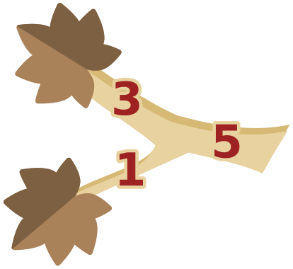

Ein Baum in Brunos Garten ist krank, alle Blätter sind vertrocknet. Bruno will den Baum retten. Dazu muss er einige Äste absägen, so dass am Ende alle Blätter entfernt sind. Dann können neue Äste mit neuen Blättern wachsen.

Bruno möchte so schnell wie möglich fertig sein.

Das Bild zeigt ein Beispiel: Um die beiden Blätter zu entfernen, kann Bruno entweder die beiden Äste mit den Blättern absägen oder nur den einen Ast, von dem die beiden anderen abzweigen. Die Zahlen geben für jeden Ast an, wie lange das Absägen dauert. Bruno wird also die beiden Äste mit den Blättern absägen, da 3 + 1 < 5.

Unten siehst du den gesamten Baum. (Der Ast zum untersten Blatt rechts hat die Zahl 1; sie ist im Bild nicht eingetragen.)

**Welche Äste wird Bruno absägen, um so schnell wie möglich fertig zu sein? Tippe die Äste im Bild an.**
