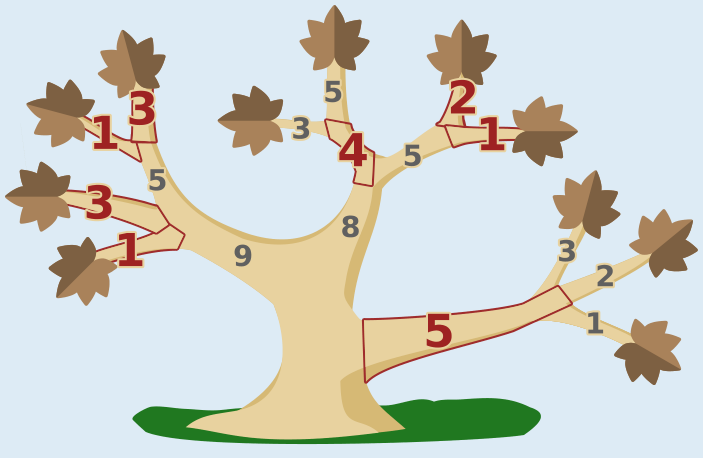

Bruno sägt die rot markierten Äste ab, um so schnell wie möglich fertig zu sein: die Blattäste 3 und 1 links unten, die Blattäste 1 und 3 links oben, den Ast 4 in der Mitte, die Blattäste 2 und 1 rechts oben in der Mitte sowie den Ast 5 rechts unten. Das dauert 20.

Aber warum ist das so? Zunächst können wir ausrechnen, wie viel Zeit Bruno benötigt, wenn er nur die Äste mit Blättern absägt – damit wäre er ja fertig:

1 + 3 + 1 + 3 + 3 + 5 + 2 + 1 + 3 + 2 + 1 = 25

Nun gehen wir in Richtung Stamm weiter und überlegen immer wieder neu, ob es schneller sein könnte, den Ast abzusägen, von dem die bisherigen Äste direkt oder indirekt abzweigen. Nach dem ersten solchen Schritt ergibt sich diese Rechnung (die Funktion „min“ berechnet das Minimum ihrer Argumente):

1 + 3 + min(5, 1 + 3) + min(4, 3 + 5) + min(5, 2 + 1) + min(5, 3 + 2 + 1) = 1 + 3 + 1 + 3 + 4 + 2 + 1 + 5 = 20

Dabei addieren wir die Zeiten der einzelnen Äste nicht zusammen, damit wir noch wissen, welche Äste abzusägen sind. Nach dem nächsten Schritt sind wir schon am Stamm angekommen:

min(9, 1 + 3 + 1 + 3) + min(8, 4 + 2 + 1) + 5 = 1 + 3 + 1 + 3 + 4 + 2 + 1 + 5 = 20

Bruno wird die Äste absägen, die den Summanden entsprechen. Schneller kann er nicht fertig sein.

## Das ist Informatik!

Bruno muss für jeden Ast entscheiden: Soll ich diesen Ast absägen oder lieber alles, was an ihm hängt, einzeln? Die Frage ist an jeder Verzweigung die gleiche, und die Antwort hängt davon ab, wie die Teilbäume weiter oben am günstigsten bearbeitet werden. Deshalb rechnet man in der Lösung von den Blättern zum Stamm: Für jeden Ast ist das beste Ergebnis das Minimum aus der Zeit für diesen Ast und der Summe der besten Ergebnisse seiner Teiläste. Man löst also zuerst die kleinen Teilprobleme und setzt aus ihnen die Lösung der größeren zusammen. Dieses Vorgehen nennt man dynamische Programmierung.

Dazu muss das Problem eine bestimmte Eigenschaft haben: Die beste Lösung für das Ganze besteht aus besten Lösungen für die Teile. Hier stimmt das, weil sich die Äste verschiedener Teilbäume nicht beeinflussen. Man muss dafür auch nicht ausprobieren, welche der vielen möglichen Auswahlen von Ästen die beste ist. Das wäre bei größeren Bäumen gar nicht mehr zu schaffen. Mit der dynamischen Programmierung genügt es, jeden Ast genau einmal zu betrachten.

Dynamische Programmierung wird bei vielen Optimierungsproblemen angewandt, zum Beispiel beim Vergleichen von DNA-Folgen und beim Berechnen kürzester Wege. Das Muster, in einem Baum von den Blättern zur Wurzel zu rechnen und dabei an jedem Knoten zu entscheiden, ob man ihn „behält“ oder durch seine Teilbäume ersetzt, taucht auch beim Vereinfachen von Entscheidungsbäumen im maschinellen Lernen auf.

*Dieser Abschnitt wurde für den Informatik-Otter ergänzt und steht nicht im Biberheft.*
