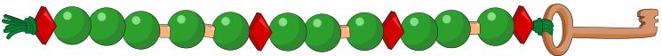

ANNA, BELLA und LENA machen Schlüsselanhänger mit ihren Namen. Sie „schreiben“ die Buchstaben mit diesen Perlen: der **grünen Kugel** und der **roten Raute**. Alle drei machen die Buchstaben genau gleich. Die **kleine orange Perle** kommt zwischen die Buchstaben.

ANNA und BELLA haben diese Schlüsselanhänger gemacht:

ANNA:

BELLA:

**Welchen Schlüsselanhänger hat LENA gemacht?**
