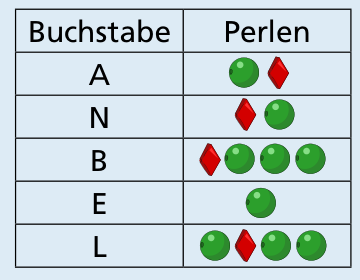

Antwort A ist richtig.

Aus den Schlüsselanhängern von ANNA und BELLA lässt sich ablesen, wie die drei Mädchen die einzelnen Buchstaben „schreiben“:

Der Schlüsselanhänger für LENA beginnt also mit Kugel, Raute, Kugel, Kugel für L, so wie die Schlüsselanhänger in den Antworten A und D. In beiden folgt eine Kugel für E, aber nur in dem von Antwort A kommt danach Raute, Kugel für N – und Kugel, Raute für A. Diesen Schlüsselanhänger hat LENA gemacht.

## Das ist Informatik!

ANNA, BELLA und LENA kodieren Buchstaben als Folgen von zwei Sorten Perlen: Kugel und Raute. Jeder Buchstabe bekommt dabei sein eigenes Perlenmuster, und die Muster sind unterschiedlich lang. Zwischen den Buchstaben liegt immer eine kleine orange Perle. In der Informatik nennt man eine eindeutige Zuordnung von Zeichen zu Zeichenfolgen eine Kodierung. Weil die Muster unterschiedlich lang sind, handelt es sich um eine Kodierung mit variabler Länge.

Warum braucht man die kleine Perle? Das Muster für E (eine Kugel) ist der Anfang vom Muster für A (Kugel, Raute). Ohne Trennzeichen wüsste man nicht, ob eine Kugel ein E oder der Beginn eines anderen Buchstabens ist. Man kann das Problem auch vermeiden, indem man die Muster so wählt, dass kein Muster der Anfang eines anderen ist; so ein Code heißt Präfixcode, und der Huffman-Code ist ein Beispiel dafür. Dann braucht man keine Trennzeichen.

Der Morse-Code arbeitet wie die Schlüsselanhänger. Er benutzt zwei Zeichen, kurz und lang, für jeden Buchstaben eine Folge davon, und lässt zwischen Buchstaben eine kurze Pause. Auch dort bekommen häufige Buchstaben kürzere Muster: Das E besteht nur aus einem kurzen Zeichen. Genauso nutzt man in der Informatik für die Speicherung von Texten und anderen Daten Kodierungen, die unterschiedlich lange Codewörter haben, wie bei UTF-8, dem heute üblichen Verfahren zur Kodierung von Text.

*Dieser Abschnitt wurde für den Informatik-Otter ergänzt und steht nicht im Biberheft.*
