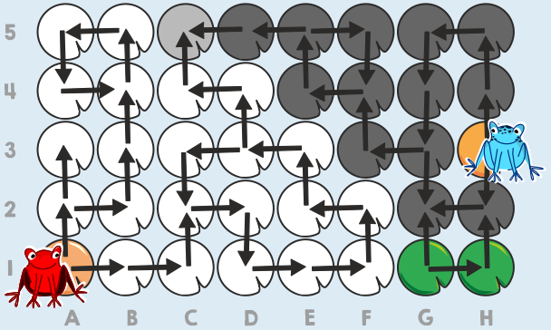

Die Frösche können sich nur auf dem Blatt C5 treffen (dritte Spalte von links, oberste Zeile).

Um die Lösung besser erklären zu können, bezeichnen wir im Seerosenblatt-Raster die Spalten mit Buchstaben (A bis H von links nach rechts) und die Zeilen mit Zahlen (1 bis 5 von unten nach oben) und können jedes einzelne Blatt benennen.

Das Bild zeigt, welche Blätter die beiden Frösche auf allen möglichen Wegen entlang der Pfeile erreichen können. Die Blätter, die der rote Frosch erreichen kann, sind weiß eingefärbt; die Blätter, die der blaue Frosch erreichen kann, sind dunkelgrau markiert. Nur das Blatt C5 ist hellgrau, weil es von beiden erreicht werden kann. Nur auf diesem Seerosenblatt können sie sich treffen.

## Das ist Informatik!

Die Seerosenblätter bilden mit den Pfeilen einen gerichteten Graphen: Die Blätter sind die Knoten, und die Pfeile sind Kanten, die man nur in einer Richtung benutzen darf. Die Frösche können nur Blätter erreichen, zu denen ein Weg entlang der Pfeile führt. Man sagt, dass ein Knoten von einem anderen aus erreichbar ist. Der Treffpunkt der Frösche ist ein Knoten, der von beiden Startpunkten aus erreichbar ist.

Um alle erreichbaren Knoten zu finden, gibt es zwei einfache Verfahren. Bei der Breitensuche besucht man zuerst alle direkten Nachfolger, dann deren Nachfolger und so weiter. Bei der Tiefensuche folgt man einem Weg so weit wie möglich und geht erst zurück, wenn es nicht weitergeht. In beiden Fällen merkt man sich die besuchten Knoten, damit man nicht im Kreis läuft. Für jeden Frosch bekommt man so eine Menge erreichbarer Blätter, und der Schnitt der beiden Mengen enthält die möglichen Treffpunkte.

Erreichbarkeit in gerichteten Graphen spielt im Internet eine Rolle: Suchmaschinen folgen Links von Seite zu Seite, um Webseiten zu finden. Ebenso kann man Fragen beantworten wie: Welche Rechner kann ein Computervirus von einem infizierten Gerät aus erreichen? Welche Programmteile werden aufgerufen, wenn eine bestimmte Funktion läuft?

*Dieser Abschnitt wurde für den Informatik-Otter ergänzt und steht nicht im Biberheft.*
