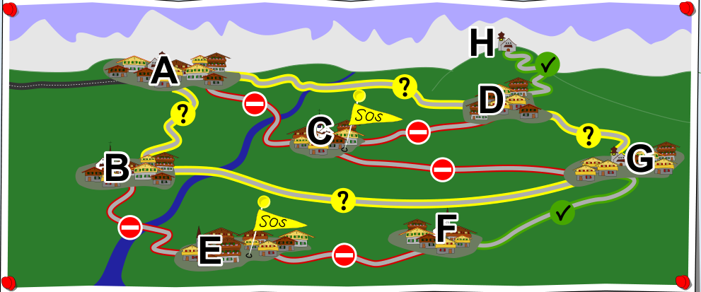

Die Karte zeigt, was wir über die Verbindungen im Straßennetz wissen: Befahrbar sind nur die Straßen zwischen G und F sowie zwischen D und H. Nicht befahrbar sind alle fünf Straßen, die zu den Dörfern C und E führen. Bei den vier Straßen zwischen A, B, G und D kann man es nicht sagen.

Zuerst stellen wir fest: Alle Straßen, die zu den nicht erreichbaren Dörfern C und E führen, müssen nicht befahrbar sein – sonst könnte man die Dörfer doch erreichen.

Als nächstes suchen wir die Straßen, die befahrbar sein müssen. Die Straße zwischen den Dörfern G und F ist nun die einzige, über die F noch erreichbar ist; sie muss also befahrbar sein. Auch die Straße zwischen D und H muss befahrbar sein, da H nur über diese Straße erreichbar ist.

Nun ist noch der „Straßenkreis“ A – B – G – D – A übrig (wobei man auch bei einem anderen Dorf anfangen könnte). Für jede einzelne der vier Straßen in diesem Kreis gilt: Sie könnte nicht befahrbar sein – dann wären die vier Dörfer A, B, D und G über die drei anderen Straßen erreichbar – oder befahrbar. Ohne weitere Information kann man also nicht sagen, ob die Straße befahrbar ist oder nicht.
