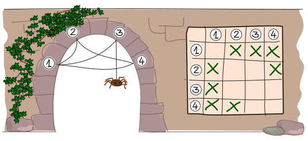
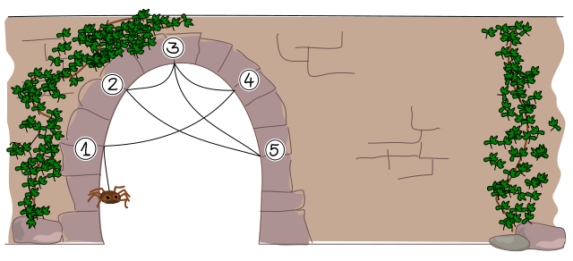

Spinne Thekla möchte möglichst viele verschiedene Netze bbauen. Deshalb notiert sie sich die Struktur jedes ihrer Netze, und zwar so:

Sie nummeriert die Endpunkte des Netzes mit 1, 2, usw. Die Struktur notiert sie dann in einem Raster, das so viele Zeilen und Spalten hat wie das Netz Endpunkte hat. Dann kreuzt sie die Felder im Raster nach dieser Regel an:

Wenn es einen Faden gibt, der von Endpunkt A zu Endpunkt B führt, kreuzt sie das Feld in Spalte A und Zeile B an.

Beachte, dass Thekla für jeden Faden zwei Kreuze macht: Ein Faden von Endpunkt A zu Endpunkt B führt auch von Endpunkt B zu Endpunkt A.

Hier siehst du ein Netz und wie Thekla seine Struktur notiert hat.

Thekla baut nun dieses Netz:

**Wie notiert Thekla seine Struktur?**
