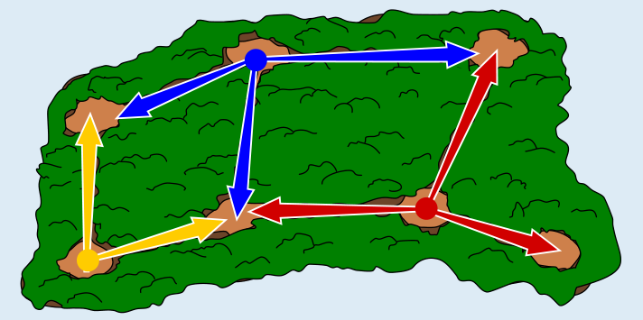

Die Försterin besetzt die Lichtungen oben in der Mitte, unten rechts der Mitte (am linken Ende der „Sackgasse“) und links unten.

Die Försterin kann drei Lichtungen mit Helfern besetzen, so dass die Helfer insgesamt alle Wege überblicken können:

Würde es auch genügen, zwei Lichtungen zu besetzen? Es gibt acht Wege. Um sie alle von nur zwei Lichtungen aus überblicken zu können, müsste es eine Lichtung geben, von der mindestens vier Wege ausgehen. Aber eine solche Lichtung gibt es nicht in diesem Wald. Es müssen also mindestens drei Lichtungen besetzt werden.

Um mit drei Lichtungen auszukommen, muss die Försterin genau die oben gezeigten Lichtungen besetzen. Zunächst kann man überlegen: Um von drei Lichtungen aus alle acht Wege zu überblicken, müssen die Helfer von jeder besetzten Lichtung aus mindestens zwei Wege „exklusiv“ überblicken, die also nicht von Helfern auf einer anderen Lichtung überblickt werden können. Unter Beachtung dieser Regel wählen wir die zu besetzenden Lichtungen aus: Um die „Sackgasse“ unten rechts zu überblicken, muss die Lichtung am linken Ende dieser Sackgasse besetzt werden. Um unter anderem den Weg oben rechts zu überblicken, muss dann die Lichtung oben Mitte besetzt werden. Als dritte Lichtung kommt dann nur noch die links unten in Frage.

## Das ist Informatik!

Die Försterin möchte mit möglichst wenigen Helfern alle Wege überblicken. Wenn man die Lichtungen als Knoten und die Wege als Kanten eines Graphen darstellt, sucht sie eine kleinste Menge von Knoten, bei der jede Kante an mindestens einem dieser Knoten endet. Das heißt in der Graphentheorie Knotenüberdeckung (englisch Vertex Cover).

Die Lösung zeigt zwei typische Schritte beim Lösen von Optimierungsproblemen. Erstens zeigt man mit einer Überlegung, dass es mit weniger nicht geht: Acht Wege lassen sich nicht von zwei Lichtungen überblicken, weil dann von einer Lichtung vier Wege ausgehen müssten. Zweitens findet man eine Lösung, die diese Grenze erreicht. Bei großen Graphen ist es schwierig, eine kleinste Überdeckung zu finden. Kein Verfahren ist bekannt, das das bei sehr großen Graphen immer schnell schafft. Man kann aber schnell eine Überdeckung finden, die höchstens doppelt so groß wie die kleinste ist: Man wählt wiederholt eine noch nicht überblickte Kante und nimmt beide Endpunkte dazu.

Anwendungen gibt es überall, wo etwas mit möglichst wenigen Einrichtungen überwacht werden soll: Kameras an Kreuzungen, die alle Straßenabschnitte erfassen, Messpunkte in einem Rechnernetz, die alle Verbindungen beobachten, oder Wachposten in einem Gebäude.

*Dieser Abschnitt wurde für den Informatik-Otter ergänzt und steht nicht im Biberheft.*
