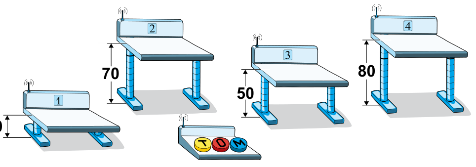

Toll: Im Klassenraum gibt es vier Tische mit elektrisch einstellbarer Höhe! Die Höhe kann mit einer Fernbedienung verändert werden. Sie hat dazu drei Tasten: eine gelbe Taste (T), eine rote Taste (O) und eine blaue Taste (M).

Jemand hat die Fernbedienung umprogrammiert. Jedesmal, wenn die Tasten gedrückt werden, passiert nun Folgendes:

- Die gelbe Taste (T) erhöht die Tische 1, 2 und 3 um jeweils 10 cm.
- Die rote Taste (O) senkt die Tische 2, 3 und 4 um jeweils 10 cm.
- Die blaue Taste (M) erhöht die Tische 1, 3 und 4 um jeweils 10 cm.

Momentan sind die Tische 1, 2, 3 und 4 auf 10 cm, 70 cm, 50 cm und 80 cm eingestellt.

Für den Unterricht sollen alle vier Tische auf 60 cm eingestellt werden.

**Wie muss man dazu die Tasten drücken?**
