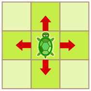

Vier Schildkröten leben in ihren kleinen Gärten. Die Gärten sind in Felder unterteilt. Jedes Feld ist entweder mit Gras oder mit Steinen bedeckt. Die Schildkröten können von einem Grasfeld zum nächsten gehen (siehe Bild). Über Steine können sie nicht gehen.

Jede Schildkröte möchte ihren Garten vollständig abgrasen. Dafür muss sie alle Grasfelder betreten, aber jedes nur genau einmal. Sie startet auf dem Feld, auf dem sie im Bild steht.

Leider kann eine Schildkröte ihren Garten nicht vollständig abgrasen.

**Welcher Garten ist das?**
