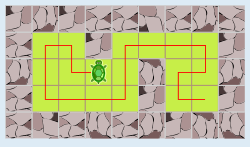
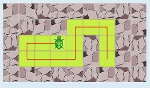
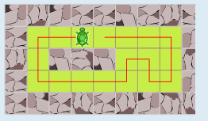
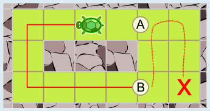
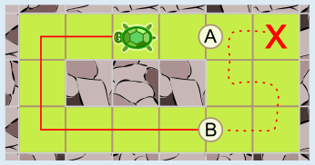
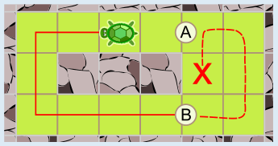

Antwort C ist richtig.

Die Gärten A, B und D können die Schildkröten vollständig abgrasen. Die Linien zeigen, welche Wege sie dazu gehen können (im Garten D gibt es mehrere Möglichkeiten).

Garten C kann nicht vollständig abgegrast werden. Ein Weg müsste jedenfalls das Stück zwischen den unten in den Abbildungen mit A und B markierten Stellen enthalten. Nun fehlt noch ein Weg von A nach B (oder umgekehrt), auf dem die Schildkröte jedes der verbleibenden sechs Grasfelder genau einmal besucht.

Es gibt jedoch keinen solchen Weg: Wenn wir bei B beginnen, zeigt sich, dass es nur drei verschiedene (Teil-)Wege über alle sechs Felder gibt. Keiner davon endet bei A. Umgekehrt, also wenn wir bei A beginnen, gibt es entsprechend keinen Weg über alle sechs Felder zu B.

## Das ist Informatik!

Jede Schildkröte sucht einen Weg, der alle Grasfelder genau einmal besucht. Stellt man die Grasfelder als Knoten und die Übergänge zwischen Nachbarfeldern als Kanten dar, ist ein solcher Weg ein Hamilton-Pfad, benannt nach dem irischen Mathematiker William Rowan Hamilton. Schon bei der Frage, ob es für eine Schildkröte überhaupt einen solchen Weg gibt, hilft das Graphenmodell, weil man nur auf die Verbindungen schaut.

Ob ein Graph einen Hamilton-Pfad besitzt, ist eine schwere Frage. Für große Graphen kennt man kein Verfahren, das immer schnell die Antwort liefert. Man probiert systematisch alle Wege aus und kehrt um, wenn man nicht weiterkommt (Backtracking), so wie in der Lösung für Garten C, in der gezeigt wird, dass alle Versuche scheitern. Ganz anders ist es bei dem verwandten Problem, einen Weg zu finden, der jede Kante genau einmal benutzt (Euler-Pfad): Dafür reicht es, die Knotengrade zu zählen.

Verwandt ist das berühmte Problem des Handlungsreisenden: Er soll mehrere Orte besuchen und möglichst wenig Strecke zurücklegen. Solche Rundreisen müssen zum Beispiel Lieferdienste planen, und auch Maschinen, die in Leiterplatten Löcher bohren, brauchen einen kurzen Weg. Weil es kein schnelles Verfahren gibt, das stets die beste Lösung liefert, setzt man in der Praxis auf Verfahren, die gute, aber nicht immer die besten Wege finden.

*Dieser Abschnitt wurde für den Informatik-Otter ergänzt und steht nicht im Biberheft.*
