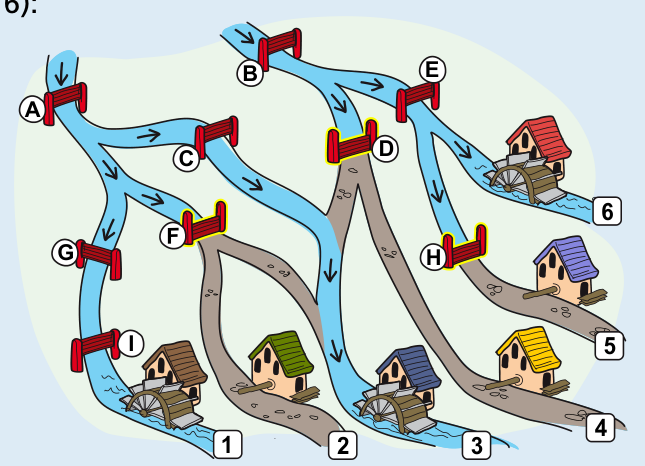

Wenn der Müller die im Bild mit D, F und H bezeichneten Sperren schließt, fließt das Wasser nicht mehr zu den Mühlen, bei denen der Müller noch das Mühlrad einbauen muss (2, 4, 5), aber weiter zu den Mühlen mit Mühlrad (1, 3, 6).

Es gibt keine andere Möglichkeit, den gleichen Wasserfluss zu erreichen:

- Die Sperren A, G und I müssen offen sein, damit Wasser zur Mühle 1 fließt.
- Weil A offen sein muss, muss F geschlossen werden, damit kein Wasser zur Mühle 2 fließt.
- Die Sperren B und E müssen offen sein, damit Wasser zur Mühle 6 fließt.
- Dann muss H geschlossen werden, damit kein Wasser zur Mühle 5 fließt.
- Weil B offen sein muss, muss D geschlossen werden, damit kein Wasser zur Mühle 4 fließt.
- Damit trotzdem Wasser zur Mühle 3 fließt, muss C offen sein.

## Das ist Informatik!

Ob Wasser zu einer Mühle fließt, hängt von den Sperren ab: Es fließt, wenn es mindestens einen Weg vom Berg bis zur Mühle gibt, auf dem alle Sperren offen sind. Das lässt sich als logische Aussage schreiben: Auf einem Weg müssen Sperre 1 UND Sperre 2 UND so weiter offen sein, und es genügt, dass dies für einen Weg gilt, also Weg 1 ODER Weg 2. Jede Sperre ist eine Variable, die offen (wahr) oder geschlossen (falsch) sein kann. Mit UND, ODER und NICHT lässt sich jede solche Bedingung beschreiben. Das ist die Aussagenlogik, die man auch Boolesche Algebra nennt.

Die Aufgabe ist dann: Finde Werte für die Variablen, bei denen drei Aussagen wahr und drei falsch sind. Das nennt man ein Erfüllbarkeitsproblem (SAT, von englisch satisfiability). Bei sehr vielen Variablen ist es schwierig, die Aufgabe zu lösen, weil es sehr viele Kombinationen gibt. Trotzdem gibt es heute Programme, die SAT-Probleme mit Millionen Variablen oft schnell lösen. Man setzt sie ein, um zum Beispiel zu überprüfen, ob ein Computerchip fehlerfrei arbeitet.

Die Verbindung zur Technik ist ganz direkt: In elektrischen Schaltungen sind Schalter in Reihe wie ein UND geschaltet und parallel wie ein ODER. Computer bestehen aus Schaltungen, die genau diese Bausteine kombinieren. Die Wassermühlen sind also ein Modell für die logischen Schaltungen im Inneren eines Computers.

*Dieser Abschnitt wurde für den Informatik-Otter ergänzt und steht nicht im Biberheft.*
