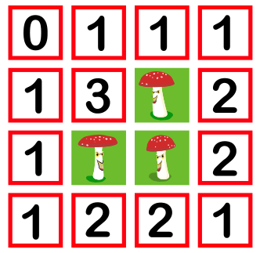
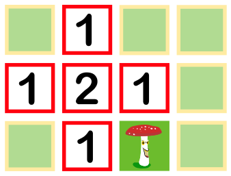

Beim Spiel „Achtung Fliegenpilz“ ist zu Beginn genau ein Fliegenpilz zu sehen. Alle anderen Felder des Spielbretts sind zugedeckt. Deckst du ein Feld auf, erscheint entweder ein weiterer Fliegenpilz oder die Anzahl der Fliegenpilze auf den Nachbarfeldern. Wenn du alle Felder aufdeckst, auf denen kein Fliegenpilz versteckt ist, hast du gewonnen.

Hier ist ein Beispiel für ein vollständig aufgedecktes Spielbrett:

Du hast ein neues Spiel begonnen und bereits einige Felder aufgedeckt – siehe unten.

**Auf welchen der übrigen (zugedeckten) Felder ist sicher kein Fliegenpilz?** Wähle alle diese Felder aus. Die zugedeckten Felder heißen A bis F: A ist oben links, B und C stehen rechts daneben (in der obersten Zeile), D ist unten links, E steht rechts in der mittleren Zeile und F unten rechts.
