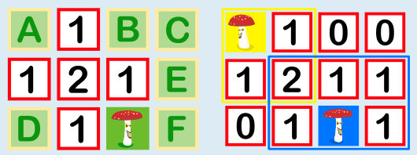

Um die richtige Antwort zu erklären, versehen wir die zugedeckten Felder mit Buchstaben. Außerdem sagen wir, dass eine Zahl N auf einem Feld „verbraucht“ ist, wenn bereits auf N Nachbarfeldern dieser Zahl je ein Fliegenpilz aufgedeckt ist; auf anderen Nachbarfeldern kann dann kein Fliegenpilz mehr sein.

- Auf Feld D ist kein Fliegenpilz, weil die Zahl 1 rechts daneben verbraucht ist.
- Auf den Feldern B, C, E und F ist kein Fliegenpilz, weil die gemeinsame Nachbarzahl 1 dieser Felder verbraucht ist.
- Auf Feld A ist ein Fliegenpilz, weil sonst die Nachbarzahlen 1, 2 und 1 die Anzahl der Fliegenpilze auf ihren Nachbarfeldern nicht korrekt angeben würden.

Also ist auf Feld A (oben links) ein Fliegenpilz versteckt. Die Felder B, C, D, E und F dürfen aufgedeckt werden. Im rechten Bild siehst du das vollständig aufgedeckte Spielbrett und wie die Zahlen auf den Feldern zustandekommen.

## Das ist Informatik!

Wie könnte ein Computerprogramm diese Biberaufgabe lösen? Wenn mindestens ein Feld mit einem Fliegenpilz aufgedeckt ist, können einfache Regeln aufgestellt werden: Bei einem Feld mit der Zahl 0 hat kein Nachbarfeld einen Fliegenpilz, man kann sie also alle aufdecken. Wenn ein Feld mit der Zahl 1 bereits ein Nachbarfeld mit einem aufgedeckten Fliegenpilz hat, dann kann es auf allen anderen Nachbarfeldern keinen weiteren Fliegenpilz geben. Wenn solche Regeln für jede Zahl genau formuliert sind, könnte ein Computer immer wieder für jedes Feld des Spielbretts prüfen, ob eine der Regeln anwendbar ist – so lange, bis entweder alle Felder aufgedeckt sind oder es kein Feld mehr gibt, das noch aufgedeckt werden kann. Insgesamt ergibt sich so ein Algorithmus, der ausgeführt werden kann, um im Spiel (mit mindestens einem aufgedeckten Fliegenpilz) so erfolgreich zu sein wie möglich.
