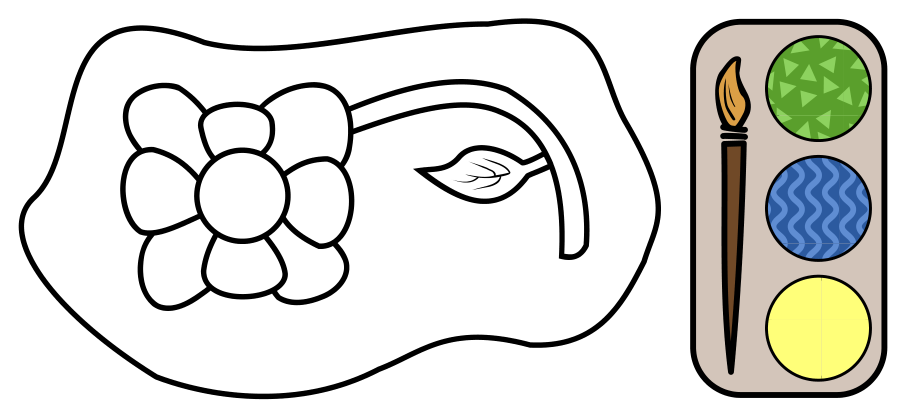

Eine Blume soll ausgemalt werden, und zwar das ganze Bild mit den drei farbigen Mustern (grün mit Dreiecken, blau mit Wellen, gelb mit Punkten). Zwei Flächen, die sich berühren, dürfen nicht das gleiche Muster haben.

Überlege dir, wie du das ganze Bild ausmalen kannst. Wie viele verschiedene richtige Möglichkeiten gibt es dafür?

**Wie viele verschiedene Möglichkeiten gibt es, das Bild richtig auszumalen?**
