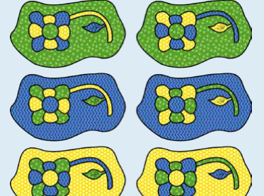
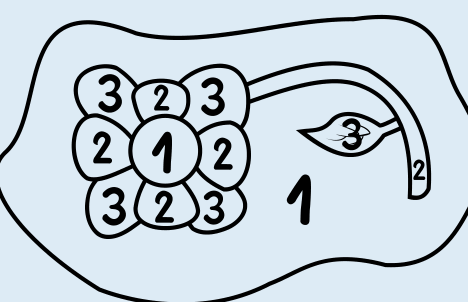

Hier siehst du alle Möglichkeiten, das Bild richtig auszumalen – also so, dass die Bedingung aus der Aufgabe erfüllt ist:

Jede einzelne Möglichkeit ergibt sich, wenn man für die äußere Fläche eine Farbe wählt und dann die anderen Flächen nach und nach so bemalt, dass die Bedingung erfüllt ist. Dabei kann nur die Mitte der Blume die gleiche Farbe bekommen wie die äußere Fläche. Die anderen Flächen muss man mit den beiden anderen Farben abwechselnd bemalen; dabei kann man mit dem Stiel anfangen.

Wenn wir der Farbe für die äußere Fläche die Nummer 1 geben, der Farbe für den Stiel die 2 und der anderen Farbe die 3 geben, sieht das so aus:

Weil es sechs Möglichkeiten gibt, den Nummern 1, 2 und 3 die Farben Gelb, Grün und Blau zuzuordnen, gibt es sechs Möglichkeiten, das Bild richtig auszumalen.

## Das ist Informatik!

In dieser Biberaufgabe hast du den Flächen Farben so zugeordnet, dass benachbarte Flächen unterschiedliche Farben haben. Informatik und Mathematik kennen solche „Färbungsprobleme“. Ganz ähnlich wie bei der Blume sollen zum Beispiel Landkarten so gefärbt werden, dass benachbarte Länder nicht gleich gefärbt sind. Es ist für jede Landkarte möglich, eine solche Färbung mit höchstens vier Farben zu finden. Das ist nicht einfach einzusehen. Erst 1976 konnten die Mathematiker Kenneth Appel und Wolfgang Haken das beweisen. Dabei mussten sie Methoden der Informatik verwenden, um eine Vielzahl von Ausnahmen und Gegenbeispielen zu überprüfen. Solche Computerbeweise werden aber kritisiert. Sie sind in der Regel so komplex, dass andere Menschen sie ohne Computer nicht nachvollziehen können.

Auch viele andere Probleme können als Färbungsprobleme aufgefasst werden. Dabei ist es meist wichtig, möglichst wenige Farben zu verwenden. Beispiele sind die Einteilung der Teams bei einem Sportturnier, das Einteilen von Personen in Gruppen oder die Zuteilung von Frequenzen für Radiosender.

Bei realistischen Anwendungen von Färbungsproblemen gibt es meistens sehr viel mehr Flächen als bei der Blume in dieser Biberaufgabe. Dann kann man die Lösung nicht ohne Hilfsmittel finden. Wie gut, dass die Informatik Methoden kennt, Färbungsprobleme mit Computerhilfe zu lösen.
