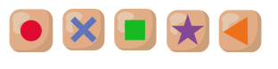

Der Boden eines quadratischen Raumes ist in 30 × 30 Felder unterteilt. Auf zehn Feldern liegen solche Chips mit farbigen Symbolen (rot: Punkt, blau: Kreuz, grün: Quadrat, lila: Stern, orange: Dreieck):

Ein Roboter soll den Boden mit diesen Symbolen bemalen, Feld für Feld. Er hat dafür vier verschiedene Regeln.

Auf einem Feld, auf dem kein Chip liegt, malt er …

1. … das Symbol des Chips, der ihm am nächsten ist.
2. … das Symbol des Chips, der am weitesten von ihm entfernt ist.
3. … das Symbol des Chips, der ihm am zweitnächsten ist.
4. … das Symbol, das bei den 6 am nächsten liegenden Chips am häufigsten vorkommt.

Der Roboter bemalt alle Felder nach derselben Regel. Wenn die Regel für ein Feld mehrere mögliche Symbole ergibt, sucht der Roboter sich zufällig eines davon aus.

Unten siehst du für jede Regel, wie der Boden am Ende bemalt ist.

**Welcher Boden passt zu welcher Regel?**
