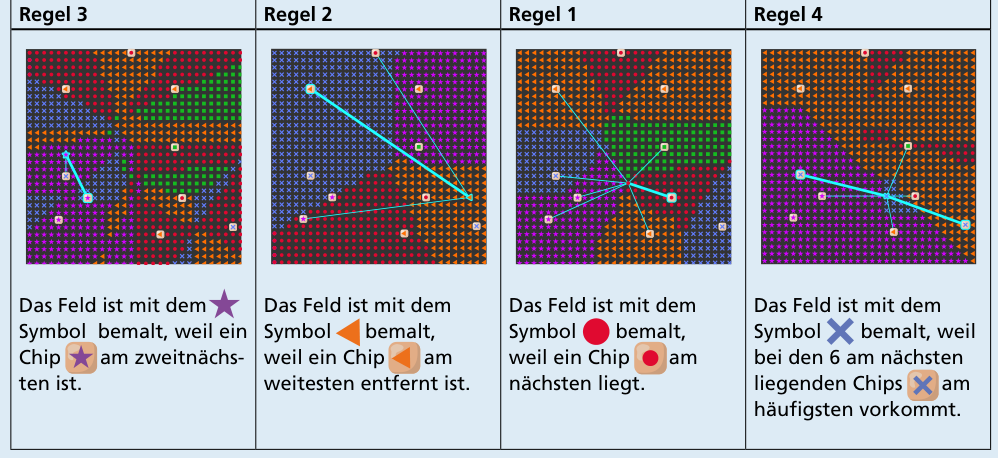

Da alle Felder eines Bodens nach derselben Regel bemalt werden, genügt es, jeweils ein Feld zu überprüfen. Für jeden Boden betrachten wir ein anderes Feld (Boden A: Regel 3, Boden B: Regel 2, Boden C: Regel 1, Boden D: Regel 4):

- Regel 3: Das Feld ist mit dem Stern bemalt, weil ein Chip mit Stern am zweitnächsten ist.
- Regel 2: Das Feld ist mit dem Dreieck bemalt, weil ein Chip mit Dreieck am weitesten entfernt ist.
- Regel 1: Das Feld ist mit dem Punkt bemalt, weil ein Chip mit Punkt am nächsten liegt.
- Regel 4: Das Feld ist mit dem Kreuz bemalt, weil bei den 6 am nächsten liegenden Chips das Kreuz am häufigsten vorkommt.

## Das ist Informatik!

Die „Mal-Regeln“ in dieser Biberaufgabe sind Algorithmen, nach denen der Roboter die Bodenfläche des Raumes in Bereiche einteilen kann. Die algorithmische Teilung von Flächen bzw. Ebenen oder auch dreidimensionalen Räumen ist auch in der Informatik von Bedeutung, etwa bei Simulationen und in der Computergrafik.

Besonders interessant ist Regel 1: Sie unterteilt die Fläche in Voronoi-Regionen, benannt nach dem ukrainischen Mathematiker Georgi Feodosjewitsch Woronoi (1868–1908). Jede Region wird durch ein Zentrum bestimmt, und alle Punkte einer Region liegen keinem anderen Zentrum näher als dem eigenen. Voronoi-Diagramme stellen die Grenzen von Voronoi-Regionen dar. Voronoi-Regionen finden vielfach Anwendung, beispielsweise in der Mobilfunkversorgung. Oder man nutzt sie für die Analyse von Fußballspielen oder anderem sozioökonomischen Verhalten, etwa den Beziehungen zwischen der Bevölkerung und den nächstgelegenen Schulen, Krankenhäusern oder bestimmten Dienstleistern.

In der Informatik sind verschiedene Algorithmen bekannt, um aus einer Menge von Punkten einer Ebene die Voronoi-Regionen bzw. das Voronoi-Diagramm zu berechnen, das diese Punkte als Zentren hat. Der Algorithmus von Fortune ist besonders effizient und folgt der allgemeinen und besonders für geometrische Probleme bedeutenden Idee der Sweep-Line-Algorithmen.
