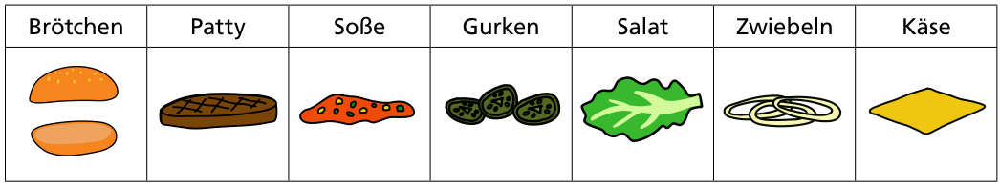

Für Biber-Burger gibt es diese Zutaten:

Echte Biber-Burger erfüllen alle diese Bedingungen:

1. Die Soße ist direkt auf dem Patty.
2. Das Patty und der Käse liegen unter den Gurken, dem Salat und den Zwiebeln.
3. Die Zwiebeln berühren nicht das Brötchen.

**Nur einer dieser Burger ist ein echter Biber-Burger. Welcher?**
