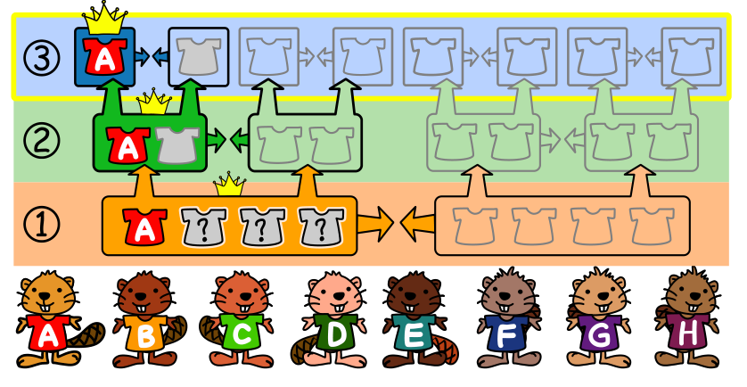

An der Bibermeisterschaft nehmen 8 Biber teil (A bis H). Es gibt drei Runden. In jeder Runde sammelt jeder Biber Punkte.

- In Runde 1 werden zwei Teams aus je 4 Bibern gebildet. Die Punkte der einzelnen Biber im Team werden aufsummiert. Das Team mit den meisten Punkten gewinnt. Diese Biber sind in Runde 2 die Spitzengruppe und spielen um die Plätze 1 bis 4. Die Verlierer machen die Plätze 5 bis 8 unter sich aus.
- Runde 2 wird mit denselben Regeln durchgeführt. Die Teams bestehen jetzt aus 2 Bibern. Das Gewinnerteam der Spitzengruppe spielt in Runde 3 um Platz 1. Die Verlierer machen die Plätze 3 und 4 unter sich aus.
- In Runde 3 treten die Biber einzeln gegeneinander an.

Biber Ada (A) erreicht Platz 1 der Bibermeisterschaft. Hier siehst du die Punkte, die jeder Biber in jeder Runde erzielt hat:

| Biber    | A  | B  | C  | D  | E  | F  | G  | H  |
|----------|----|----|----|----|----|----|----|----|
| Runde 1  | 15 | 16 | 19 | 18 | 17 | 20 | 19 | 19 |
| Runde 2  | 20 | 27 | 30 | 24 | 28 | 24 | 30 | 30 |
| Runde 3  | 10 | 14 | 11 | 15 | 16 | 13 | 9  | 12 |

**Welche drei Biber waren in Adas Team in Runde 1?** Wähle die drei Biber aus, die zusammen mit Ada in einem Team waren (Ada selbst wählst du nicht aus).
