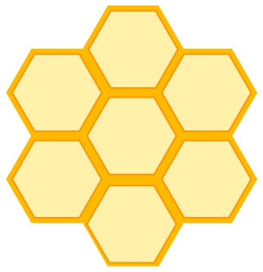

Die Bienen wollen auf die sieben Waben. Unter jeder Biene zeigt ein Hinweis, wann eine Wabe für sie richtig ist: Die dunkle Wabe im Hinweis ist die Wabe der Biene, die hellen Waben zeigen, wie die übrigen Waben dazu liegen müssen.

**Ordne jeder Biene eine richtige Wabe zu!** Jede Wabe darf nur einmal vergeben werden.
