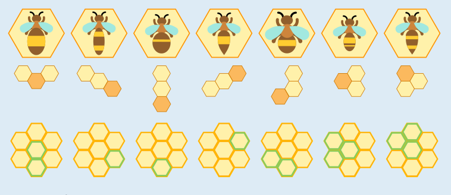

Wie kannst du diese Biberaufgabe geschickt lösen? Schau dir die Hinweise für die Bienen genauer an. Unten siehst du noch einmal die Bienen und die Hinweise. Außerdem wird für jede Biene angezeigt, welche Waben wegen des Hinweises für sie richtig sein können.

Du siehst, dass es für drei Bienen jeweils nur eine richtige Wabe gibt. Diese Bienen kannst du direkt auf diese Waben ziehen. Danach bleibt für die erste Biene ganz links und die fünfte Biene auch nur noch je eine richtige Wabe übrig, und du kannst sie dorthin ziehen. Und dann ist auch für die beiden rechten Bienen nur noch je eine richtige Wabe übrig.

Die richtige Zuordnung: Biene 1 in die Mitte, Biene 2 rechts unten, Biene 3 unten, Biene 4 rechts oben, Biene 5 links unten, Biene 6 links oben, Biene 7 oben.

Du kannst auch versuchen, die Bienen von links der Reihe nach auf die Waben zu ziehen; zuerst Biene 1, dann 2 usw. Wenn du dabei aber Biene 1 in die Wabe ganz unten ziehst, ist diese Wabe für Biene 3 nicht mehr frei. Damit Biene 3 auf ihre einzige richtige Wabe kann, musst du Biene 1 also noch einmal „umziehen“. Das ist unnötig umständlich. Es lohnt sich also, die Hinweise genau zu betrachten und geschickt vorzugehen.

## Das ist Informatik!

In dieser Biberaufgabe müssen sieben Bienen auf sieben verschiedenen Waben untergebracht werden. Dafür gibt es über 5.000 Möglichkeiten! Wenn man die Hinweise berücksichtigt, verringert sich die Anzahl der Möglichkeiten stark. Es wäre aber immer noch aufwändig, alle verbliebenen Möglichkeiten auszuprobieren. Der Schlüssel zu einer schnellen Lösung der Aufgabe ist die richtige Reihenfolge bei der Platzierung der Bienen. Konkret hatten wir dazu diese Idee: Wenn man zuerst diejenigen Bienen platziert, für die es nur eine richtige Wabe gibt, macht man nichts falsch, und mit ein wenig Glück sind danach die Möglichkeiten für die anderen Bienen noch weiter eingeschränkt.

Unsere Idee hat also geholfen, die Aufgabe schneller zu lösen, und gleichzeitig nicht verhindert, überhaupt eine Lösung zu finden. Solch eine hilfreiche Idee nennt man in der Informatik Heuristik. Bei besonders schwierigen Problemen geht es nicht ohne Heuristiken. Wenn bei einem Problem aber nicht nur irgendeine, sondern die beste Lösung gesucht ist, kann eine Heuristik zu Lasten der Lösungsqualität gehen. Die Informatik untersucht dann, wie stark die Heuristik-Lösung von einer besten Lösung abweichen kann. Dann kann man sich gründlich überlegen, ob man sich mit der Heuristik-Lösung zufrieden gibt. Ein Beispiel ist das Planen einer Route in einem Navigationssystem. Um garantiert die beste Route zu finden, müsste jede der sehr vielen möglichen Routen berechnet und mit den anderen verglichen werden. Das wäre mit hohem Rechenaufwand verbunden. Man kann aber auch heuristisch vorgehen und z. B. nur die Möglichkeiten ausprobieren, die mit hoher Wahrscheinlichkeit zu einer guten Lösung führen. So wird in kurzer Zeit eine gute Route ermittelt, anstatt sehr lange Zeit für die Berechnung der garantiert besten Route zu benötigen.
