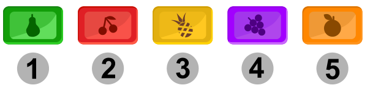
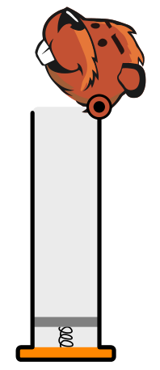

Anna füllt fünf Bonbons in einen Spender. Danach isst sie die Bonbons so nacheinander, wie sie oben aus dem Spender kommen. Sie möchte die Bonbons in dieser Reihenfolge essen: erst Bonbon 1, dann 2, 3, 4 und zuletzt 5.

**Wie muss Anna die Bonbons in den Spender füllen?** Bringe die Bonbons in die Reihenfolge, in der sie im Spender von oben nach unten liegen müssen.
