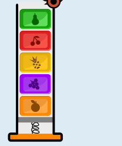

Der Spender gibt immer nur das oberste Bonbon aus. Das Bonbon, das ganz unten in den Spender gefüllt wird, kommt also als letztes heraus. Damit die Bonbons so nacheinander herauskommen, wie Anna sie essen möchte, muss der Spender so gefüllt werden:

## Das ist Informatik!

Wenn Anna die Bonbons in den Spender füllt, muss sie auf die richtige Reihenfolge achten. Bei der Herausgabe der Bonbons kehrt der Spender die Reihenfolge, in der die Bonbons hineingefüllt wurden, nämlich um. Das liegt daran, dass der Spender das oberste Bonbon – und damit das letzte Bonbon, was eingefüllt wurde – zuerst ausgibt. Das könnte man auf Englisch so ausdrücken: „last in, first out“ (zuletzt hinein, zuerst heraus), kurz: LIFO.

Die Informatik kennt eine Struktur zur Speicherung von Daten, die ähnlich funktioniert wie der Spender, nämlich nach dem LIFO-Prinzip. Diese Struktur heißt Stack, auf Deutsch: Stapel. Natürlich kann man sie nur dann sinnvoll verwenden, wenn man auf die gespeicherten Daten nach dem LIFO-Prinzip zugreifen will. Das scheint eine starke Einschränkung zu sein. Aber weil Stacks in Computern sehr einfach zu realisieren sind, werden sie dennoch recht häufig verwendet.

Das LIFO-Prinzip kommt beim Informatik-Biber 2022 auch in der Aufgabe „Muttern und Schrauben“ vor.
