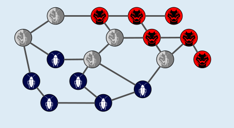
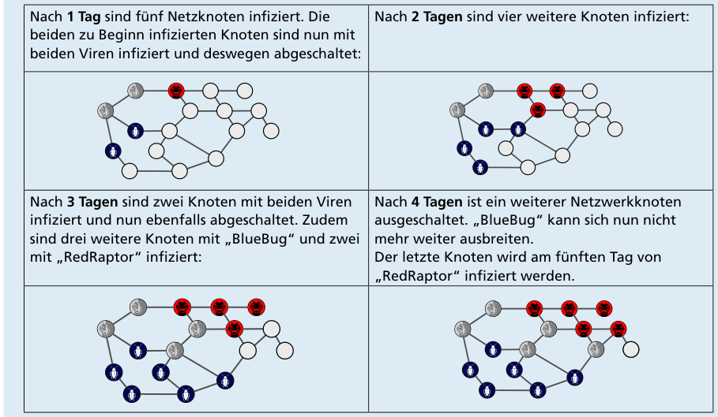

Nach fünf Tagen sind alle Netzwerkknoten infiziert oder abgeschaltet, und zwar so:

Die Viren haben sich in dieser Zeit so ausgebreitet:

- Nach 1 Tag sind fünf Netzknoten infiziert. Die beiden zu Beginn infizierten Knoten sind nun mit beiden Viren infiziert und deswegen abgeschaltet.
- Nach 2 Tagen sind vier weitere Knoten infiziert.
- Nach 3 Tagen sind zwei Knoten mit beiden Viren infiziert und nun ebenfalls abgeschaltet. Zudem sind drei weitere Knoten mit „BlueBug“ und zwei mit „RedRaptor“ infiziert.
- Nach 4 Tagen ist ein weiterer Netzwerkknoten abgeschaltet. „BlueBug“ kann sich nun nicht mehr weiter ausbreiten. Der letzte Knoten wird am fünften Tag von „RedRaptor“ infiziert werden.

## Das ist Informatik!

In Computernetzen stellen Viren und andere Schadsoftware (allgemein englisch: Malware) eine große Bedrohung dar. Sie beeinflussen nicht nur die Leistungsfähigkeit der betroffenen Computer, sondern in der Regel haben sie eine „Nutzlast“ (payload), die gezielt Schaden anrichtet. In manchen Fällen werden übertragene Daten mitgelesen und so sensible Informationen wie Passwörter oder Benutzerdaten herausgefunden und an einen Auftraggeber übermittelt (Spyware). In anderen Fällen werden Daten auf dem befallenen Computer verschlüsselt. Damit der Zugriff auf die Daten wieder möglich wird, muss erst ein Geldbetrag auf ein anonymes Konto überwiesen werden (Ransomware). Manchmal werden Gruppen infizierter Computer ferngesteuert, um Angriffe auf andere Computer durchzuführen (Botnets).

Dass eine Malware einen Computer zur Abschaltung bringt, wie in dieser Biberaufgabe, ist meist nicht beabsichtigt, denn dadurch wird die Verbreitung gestoppt. Manche Malware wird aber gezielt für Sabotage und Cyberkrieg (Cyberwarfare) entwickelt. Dadurch können betroffene Computer sogar dauerhaft beschädigt werden.

Die Einspielung aktueller Sicherheitsupdates ist eine wichtige Voraussetzung für die Abwehr von Malware. „Virenschutz“-Software kann den Schutz verbessern, ist aber in manchen Betriebssystemen schon enthalten. Regelmäßige Datensicherungen und Wachsamkeit im Bezug auf ungewöhnliches Verhalten von Informatiksystemen sind aber unabdingbar.
