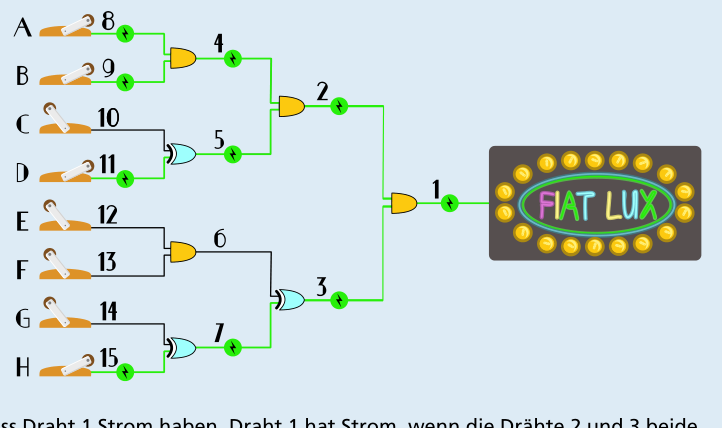

---
answers:
  - { a: on, b: on, c: on, e: on, f: on }
  - { a: on, b: on, c: on, e: on, f: on, g: on, h: on }
  - { a: on, b: on, c: on, g: on }
  - { a: on, b: on, c: on, h: on }
  - { a: on, b: on, c: on, e: on, g: on }
  - { a: on, b: on, c: on, f: on, g: on }
  - { a: on, b: on, c: on, e: on, h: on }
  - { a: on, b: on, c: on, f: on, h: on }
  - { a: on, b: on, d: on, e: on, f: on }
  - { a: on, b: on, d: on, e: on, f: on, g: on, h: on }
  - { a: on, b: on, d: on, g: on }
  - { a: on, b: on, d: on, h: on }
  - { a: on, b: on, d: on, e: on, g: on }
  - { a: on, b: on, d: on, f: on, g: on }
  - { a: on, b: on, d: on, e: on, h: on }
  - { a: on, b: on, d: on, f: on, h: on }
---
Es gibt insgesamt 16 richtige Schalterstellungen, zum Beispiel A, B, C, E, F. Wenn man die Schalter so stellt wie im Bild, leuchtet das Schild.

Um alle richtigen Schalterstellungen zu ermitteln, geht man am besten vom Leuchtschild aus rückwärts. Die Drähte wurden nummeriert und die Schalter mit Buchstaben bezeichnet, um über sie sprechen zu können.

Damit das Schild leuchtet, muss Draht 1 Strom haben. Draht 1 hat Strom, wenn die Drähte 2 und 3 beide Strom haben.

Draht 2 hat Strom, wenn die Drähte 4 und 5 beide Strom haben. Das ist der Fall, wenn (a) Schalter A und B beide an sind und (b) genau einer der Schalter C und D an ist. Insgesamt hat Draht 2 Strom, wenn entweder die Schalter A, B und C oder die Schalter A, B und D an sind.

Draht 3 hat Strom, wenn genau einer der Drähte 6 und 7 Strom hat. Draht 6 hat Strom, wenn Schalter E und F an sind. Draht 7 hat Strom, wenn entweder Schalter G oder Schalter H an sind – und keinen Strom, wenn G und H gleichzeitig an oder gleichzeitig aus sind. Insgesamt hat Draht 3 Strom, wenn die Schalter in einer dieser Kombinationen an sind: E, F oder E, F, G, H (dann hat nur Draht 6 Strom) oder G oder H (dann hat nur Draht 7 Strom). Wenn nur einer von G oder H an ist (und nur Draht 7 Strom hat), kann zusätzlich auch noch einer von E oder F an sein, ohne dass Draht 6 Strom bekommt: E, G oder F, G oder E, H oder F, H. Für Draht 3 gibt es also insgesamt acht Möglichkeiten.

Die beiden Möglichkeiten für Draht 2 lassen sich mit den acht Möglichkeiten für Draht 3 beliebig kombinieren. Insgesamt gibt es also 16 Möglichkeiten, die Schalter so zu stellen, dass das Schild leuchtet.

## Das ist Informatik!

Die Drähte im Spiel „Fiat Lux“ haben entweder Strom oder nicht; man könnte sagen, sie sind entweder an oder aus, wie die Schalter. Es gibt also für Drähte und Schalter jeweils nur zwei Zustände. Die Unterscheidung zwischen zwei Zuständen ist die kleinstmögliche Informationseinheit. In der Informatik wird sie als Bit bezeichnet. Mit Bits kann man rechnen, ähnlich wie mit Zahlen: Die Zustände nennt man dann meist 0 und 1 (statt „aus“ und „an“), und man verwendet Bit-Operationen, wie zum Beispiel AND (deutsch: „und“) oder XOR („exklusives oder“). Diese beiden Operationen „verrechnen“ zwei Bits b1 und b2, und zwar so:

- b1 AND b2 gleich 1 genau dann, wenn b1 und b2 gleich 1 sind
- b1 XOR b2 gleich 1 genau dann, wenn genau eines der Bits b1 und b2 gleich 1 ist.

Das gelbe Bauteil in dieser Biberaufgabe realisiert also das AND, das blaue Bauteil das XOR.

Bits und auch Bit-Operationen können auch in Wirklichkeit mit einfachen und günstigen Bauteilen realisiert werden; insbesondere gilt das für die kombinierte Operation NAND („nicht und“). Interessant ist, dass alle Berechnungen, die mit Bits überhaupt möglich sind, alleine mit Schaltungen aus NANDs realisiert werden können. Das ist ein wichtiger Grund für die Bedeutung von Computern: dass sie aus wenigen einfachen, billigen und heutzutage mikroskopisch kleinen Elementen gebaut werden können.
