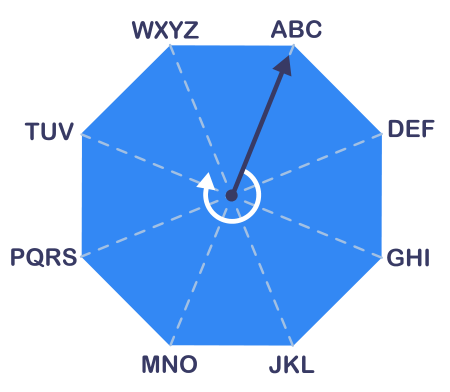

Mit dieser achteckigen Scheibe werden Worte verschlüsselt. Der Zeiger auf der Scheibe kann auf acht verschiedenen Positionen stehen. An jeder Position ist eine Folge von Buchstaben.

Am Anfang steht der Zeiger immer bei der Folge ABC. Dann wird jeder Buchstabe des Wortes einzeln verschlüsselt, und zwar mit zwei Ziffern:

- Die erste Ziffer gibt an, um wie viele Positionen der Zeiger im Uhrzeigersinn weiter gedreht wird, damit er bei der Folge mit diesem Buchstaben steht.
- Die zweite Ziffer gibt an, der wievielte Buchstabe in der Folge verschlüsselt wird.

Ein Beispiel: Das Wort PAAR wird so verschlüsselt: 51 31 81 53

**Welches Wort wird so verschlüsselt: 22 61 62 74 ?**
