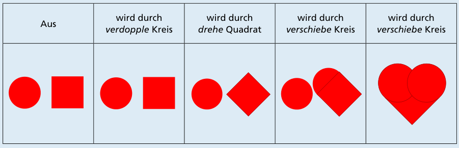

Antwort A ist richtig.

Wenn man sich das Herz genau anschaut, stellt man fest, dass es aus zwei Kreisen und einem um 1/8 (45 Grad) gedrehten Quadrat besteht. Es braucht in den Umwandlungen also ein „verdopple Kreis“, damit man zwei Kreise hat, und ein „drehe Quadrat“, damit das Quadrat um 1/8 gedreht werden kann. Damit fallen die Antworten B, C und D weg, denn:

- In der Antwort B wird ein Quadrat verdoppelt und kein Kreis.
- In der Antwort C wird ein Kreis gedreht, aber nicht das Quadrat.
- In der Antwort D wird gar keine Form gedreht, also insbesondere nicht das Quadrat.

Mit den Umwandlungen aus Antwort A kann Tina das Herz machen:

## Das ist Informatik!

Wir kennen Tina nicht näher und wissen nicht, ob sie vielleicht ein Roboter sein könnte – zum Beispiel der aus der Biberaufgabe „Roboter Tina“ vom Informatik-Biber 2022. Auf jeden Fall hat sie das Herzbild so erstellt, wie es auch ein Computerprogramm machen würde: Für ihr Kunstwerk hatte sie einfache Bilder (Kreis und Quadrat) und einige Operationen zur Verfügung. Sie hat nacheinander einige Operationen ausgeführt und sie dabei auf die einfachen Bilder angewandt. So entstand ein aus einfachen Bildern zusammengesetztes neues Bild, nämlich das Herz.

Auch in Computerprogrammen gibt es einfache Dinge wie Zahlen oder einzelne Buchstaben (und andere Schriftzeichen) und daraus zusammengesetzte Dinge, wie mehrere Zeichen hintereinander (auch Zeichenketten genannt), Listen mit Zahlen darin und vieles mehr. Auf diese Dinge – in der Informatik oft Objekt genannt – können Operationen angewandt werden: Für Zahlen gibt es die üblichen Rechenoperationen, eine Zeichenkette kann man in mehrere neue aufteilen oder mehrere Zeichenketten zu einer zusammenfügen, und so weiter. Letztlich besteht ein Computerprogramm aus einer Folge von Anweisungen, und die meisten Anweisungen sind Anwendungen von Operationen auf Objekte.
