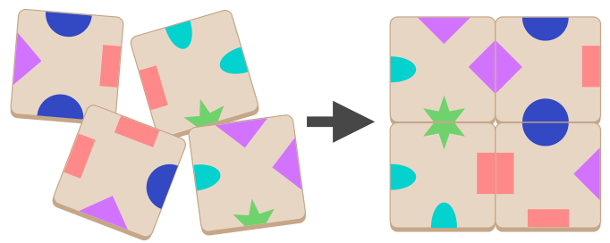

Du sollst mit vier Karten ein Quadrat legen. Dabei müssen je zwei sich berührende Ränder das gleiche Symbol zeigen. Mit diesen vier Karten kannst du ein solches Quadrat legen:

Mit vier der fünf folgenden Karten (A bis E) kannst du ebenfalls ein solches Quadrat legen. Die Karten dürfen gedreht werden.

**Welche Karte kannst du dabei NICHT verwenden?**
