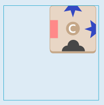
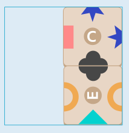
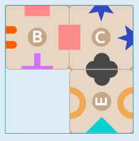
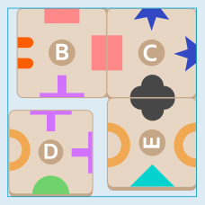
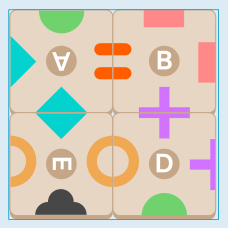
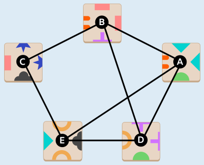

Antwort C ist richtig.

Es gibt (5 über 4) · 4! · 4⁴ = 30720 verschiedene Möglichkeiten, vier von den fünf Karten auszuwählen und zu legen. Das sind viel zu viele, um sie alle auszuprobieren und dann jede Auswahl zu prüfen, ob sie sich zu einem Kartenquadrat legen lässt. Es ist also klug, sich die Karten näher anzusehen und dabei insbesondere die Verteilung der Symbole. Diese ist nämlich dafür zuständig, ob und wie sich die Karten aneinander legen lassen.

Zunächst fällt auf, dass der blaue halbe Stern nur auf Karte C vorkommt. Da er zudem gleich zweimal und zwar über Eck vorkommt, können nur an den anderen Seiten Karten angelegt werden. In einem Kartenquadrat könnte C also nur in der Ecke liegen.

An die Seite mit der halben schwarzen Wolke kann man nun allein Karte E anlegen.

Für das rote Rechteck gibt es ebenfalls nur eine Karte, nämlich B. Diese hat zwar rote Rechtecke an zwei Seiten, aber da es keine weitere Karte mit roten Rechtecken gibt, muss sie so gedreht werden, dass das zweite rote Rechteck nach außen zeigt.

Als letztes braucht es nun eine Karte mit einem halben lila Kreuz und einem hellbraunen Halbkreis. Karte D hat sogar diese Symbole, sie sind jedoch in der falschen Reihenfolge: Der Halbkreis müsste im Uhrzeigersinn direkt nach dem Kreuz kommen, es ist aber umgekehrt.

Da es in keinem Schritt eine andere Karte hätte angelegt werden können, kann also Karte C nicht verwendet werden, um ein Kartenquadrat zu legen. Aus den anderen Karten lässt sich jedoch ein solches Quadrat legen (A, B, D und E).

## Das ist Informatik!

Wenn zwei Karten das gleiche Symbol zeigen, können sie aneinander gelegt werden. Das kann man mit Hilfe eines Graphen darstellen: Die Karten sind die Knoten, und wenn zwei Karten das gleiche Symbol zeigen, dann sind sie durch eine Kante verbunden. Für die fünf Karten dieser Biberaufgabe sieht der Graph so aus:

Ein Rundweg über die Kanten des Graphen, an dem vier Knoten (also Karten) beteiligt sind, entspricht einem Kartenquadrat, in dem immer zwei aneinander liegende Karten das gleiche Symbol zeigen. Das ist aber nicht zwingend ein „echtes“ Kartenquadrat im Sinne dieser Biberaufgabe: Ein Rundweg ist nämlich auch dann möglich, wenn die sich im Quadrat berührenden Ränder nicht zueinander passen. Andersherum gilt aber: Für ein echtes Kartenquadrat gibt es im Graphen einen Rundweg mit vier Karten.

Deshalb kann man sich auf die Rundwege mit vier Karten konzentrieren, wenn man ein echtes Kartenquadrat finden will. Während es viele Tausend Möglichkeiten gibt, aus den fünf Karten ein Quadrat zu legen, gibt es in dem Graphen nur drei Rundwege mit vier Karten: A-E-C-B-A, A-E-D-B-A und B-D-E-C-B. Nur für den Rundweg A-E-D-B-A lassen sich die Karten so drehen, dass auch die Ränder der Karten zueinander passen.
