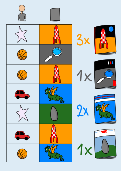

Das Buch mit der Rakete wurde am häufigsten ausgeliehen.

Die Tabelle enthält für jede Ausleihe ein Paar: Ausleihendes Kind und geliehenes Buch. Um die richtige Antwort zu finden, genügt es, bei den geliehenen Büchern nachzuzählen:

- Das Buch mit der Rakete kommt dreimal vor.
- Das Buch mit der Lupe kommt einmal vor.
- Das Buch mit dem Drachen kommt zweimal vor.
- Das Buch mit dem Hinkelstein kommt einmal vor.

Also haben die Kinder das Buch mit der Rakete am häufigsten ausgeliehen.

## Das ist Informatik!

Es ist schön, dass die Kinder in dieser Biberaufgabe gerne Bücher lesen! Aber braucht die Bibliothek wirklich eine Tabelle, um die Ausleihen darzustellen? Man könnte auch ein Bild mit Linien zeichnen. Das wäre für Menschen einfacher (wenn es nicht zu viele Ausleihen sind), aber nicht für Computer. Computer können Bilder mit Linien nicht gut lesen, sind aber sehr gut bei der Arbeit mit Tabellen. Wenn wir wollen, dass Computer uns helfen – zum Beispiel wenn wir uns merken und wieder nachschauen wollen, welches Kind welches Buch ausgeliehen hat – dann ist es eine gute Idee, die Daten so zu speichern, dass der Computer sie gut verarbeiten kann: zum Beispiel in Tabellen.

Tabellen stellen Beziehungen (bzw. Relationen, in der Sprache der Mathematik) dar. In der Bibliothek kann es eine Kundentabelle geben, in der die Ausleihenden mit ihren persönlichen Daten wie Name und Anschrift in Beziehung gesetzt werden. Außerdem ist eine Büchertabelle sinnvoll, in der für jedes Buch u. a. Titel und Autorin/Autor enthalten sind. Eine Ausleihtabelle wie in dieser Biberaufgabe beschreibt dann eine Relation zwischen Kunden und Büchern. Dass diese Relation in einer eigenen Tabelle gespeichert wird, erlaubt es, dass man mehrere Bücher ausleihen kann.

Die Informatik hat Systeme entwickelt, die große Datenmengen in Tabellen effizient speichern und verarbeiten können: die relationalen Datenbanken. Sie bilden die Grundlage vieler wichtiger Informatik-Anwendungen.
