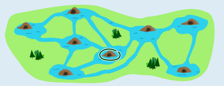
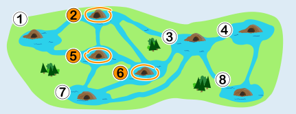
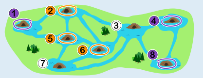

Lili wohnt in der Burg 6 (in der Mitte unten, ein Stück rechts von der Mitte der Karte; die Burgen sind in den Bildern unten nummeriert).

Um die Frage zu beantworten, ist es hilfreich, die Kanäle zwischen den Burgen zu betrachten. Es gibt drei Burgen, von denen vier Kanäle abgehen – deren Bewohner also vier Nachbarn haben: 2, 5 und 6. Lili, Peter und Simon leben in je einer dieser drei Burgen.

Nun müssen wir herausfinden, in welcher der drei Burgen Lili wohnt. Wir wissen, dass von Ninas Burg genau zwei Kanäle abgehen. Also lebt Nina in einer dieser Burgen: 1, 4 oder 8.

Weil Simon und Peter die beiden Nachbarn von Nina sind, können wir folgern, dass

- Nina in der Burg 1 wohnt und
- Simon und Peter in den Burgen 2 und 5 wohnen (oder anders herum).

Also kann Lili nur in Burg 6 wohnen.

## Das ist Informatik!

Burgen und Kanäle bilden ein Netzwerk, in dem jeder Kanal zwei Biberburgen miteinander verbindet. Ein solches Netzwerk von Verbindungen oder Beziehungen zwischen Objekten wird in Informatik und Mathematik gerne als Graph modelliert. Ein Graph besteht aus einer Menge von Knoten und einer Menge von Kanten, die jeweils zwei Knoten miteinander verbinden. Das Burgen-Kanäle-Netzwerk in dieser Biberaufgabe kann also als Graph modelliert werden, und zwar mit den Burgen als Knoten und den Kanälen als Kanten.

Graphen sind ein sehr vielseitiges Modell, auch weil es interessante Varianten gibt: Die Kanten können eine Richtung haben (dann sind die Kanten geordnete Paare) oder nicht (dann sind sie Mengen mit zwei Elementen). Außerdem können Kanten Werte haben, die auch als Gewichte bezeichnet werden; damit könnte man im Burgen-Kanäle-Netzwerk die Länge der Kanäle modellieren.

Weitere Anwendungsbeispiele für Graphen sind soziale Strukturen, Straßennetze, Computernetze, elektrische Schaltungen, Versorgungsnetze oder chemische Moleküle. Diese Vielseitigkeit bringt es mit sich, dass sich in Bezug auf Graphen viele Fragen ergeben, zum Beispiel: Was ist der kürzeste Weg – über möglichst wenige Kanten, oder über Kanten mit möglichst geringer Gewichte-Summe – zwischen zwei Knoten? Gibt es einen Rundweg über alle Knoten? Die Informatik kann viele „Graphen-Fragen“ (wie etwa die erste Beispielfrage) mit effizienten Algorithmen gut beantworten, während für einige andere Fragen (wie die zweite Beispielfrage) keine effizienten Algorithmen bekannt sind.
