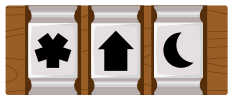
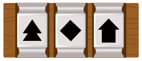
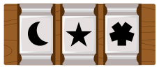
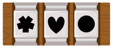
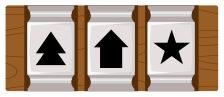

Maria findet eine geheimnisvolle Kiste. Ob ein Schatz darin versteckt ist? Leider ist die Kiste verschlossen. Um sie zu öffnen, muss Maria den „Schlüssel“ herausfinden: die richtige Kombination aus drei Symbolen.

Zum Glück findet sie neben der Kiste auch diese Hinweise zu einigen falschen Kombinationen:

| Nr. | Kombination | Hinweis |
|---|---|---|
| 1 |  | Eines der Symbole ist Teil des Schlüssels und steht an der richtigen Position. |
| 2 |  | Keines der Symbole ist Teil des Schlüssels. |
| 3 |  | Zwei Symbole sind Teil des Schlüssels. Beide stehen aber an der falschen Position. |
| 4 |  | Ein Symbol ist Teil des Schlüssels. Es steht aber an der falschen Position. |
| 5 |  | Ein Symbol ist Teil des Schlüssels. Es steht aber an der falschen Position. |

**Eine dieser Kombinationen ist der Schlüssel für Marias Kiste. Welche?**
