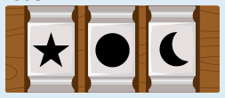

Antwort B ist richtig.

Können wir den Hinweisen entnehmen, welche Symbole Teil des Schlüssels sind und an welchen Positionen sie stehen?

Nach Hinweis 2 sind diese Symbole nicht Teil des Schlüssels: Tanne, Raute und Haus. Hinweis 5 gibt an, dass ein Symbol Teil des Schlüssels ist, sich aber an der falschen Position befindet. Da Tanne und Haus bereits ausgeschlossen sind, wissen wir, dass der Stern Teil des Schlüssels ist, aber nicht hinten im Schlüssel steht.

Aus Hinweis 3 kann man schließen, dass der Stern auch nicht in der Mitte steht. Er steht also vorne im Schlüssel. Das ist nur bei Antwort B der Fall; deshalb kann nur sie richtig sein.

Aus den Hinweisen kann man auch auf die beiden noch fehlenden Symbole und deren Positionen schließen. Hinweis 1 zeigt, dass ein Symbol Teil des Schlüssels ist und an der richtigen Position steht. Das Haus ist ausgeschlossen, und vorne im Schlüssel steht nicht die Blüte (Asterisk). Also steht der Mond hinten im Schlüssel.

Auch ein Symbol aus Hinweis 4 ist Teil des Schlüssels, steht aber an der falschen Position. Die Blüte ist bereits ausgeschieden, und nur die Mitte ist noch frei. Daher kann das Herz nicht Teil des Schlüssels sein – aber der Kreis, und der steht in der Mitte. Der Schlüssel sieht insgesamt also so aus:

Der Schlüssel kann auch anders ermittelt werden. Jeder Weg führt aber zum gleichen Ergebnis.

## Das ist Informatik!

Bei dieser Biberaufgabe konnten wir ganz ähnlich vorgehen wie bei den „Bienenwaben“, um die richtige Antwort zu finden: Wir sind vorrangig den Hinweisen gefolgt, welche die Menge der möglichen richtigen Antworten stark einschränken. Und durch die Hinweise wurden eine Reihe von Bedingungen angegeben, die der Schlüssel für Marias Kiste erfüllen muss, wie beim „Biber-Burger“. Da wir hier das Objekt bestimmen sollten, das alle Bedingungen erfüllt, haben wir bei dieser Aufgabe wirklich ein Constraint Satisfaction Problem gelöst.

Wie kann ein Computerprogramm so ein Problem lösen? Es gibt insgesamt 336 Möglichkeiten, die 8 Symbole auf die 3 Positionen des Schlüssels zu platzieren. Ein Computerprogramm könnte all diese möglichen Antworten auf die Frage nach dem Schlüssel aufzählen und jede prüfen, ob sie alle durch die Hinweise gegebenen Bedingungen erfüllt. Bei nur 336 Möglichkeiten würde diese vollständige Suche nach der richtigen Antwort sehr schnell erfolgreich beendet sein. In den meisten realistischen Problemen gibt es aber sehr viel mehr mögliche Antworten, und dann ist eine solche Brute-Force-Strategie nicht brauchbar (s. auch die „Bibermeisterschaft“).

Besser geht es mit Backtracking: Bei dieser Suchstrategie werden alle möglichen Antworten schrittweise konstruiert und dabei schon für Teilantworten die Bedingungen überprüft. Erfüllt eine Teilantwort eine Bedingung nicht, können alle Antworten, die diese Teilantwort enthalten, bei der Suche ignoriert werden. Ein Beispiel: Wir platzieren die Blüte (Asterisk) auf die erste Position im Schlüssel. Das steht in Widerspruch zu Hinweis 4: Wenn die Blüte Teil des Schlüssels wäre, stünde sie nicht auf der ersten Position. Damit können alle möglichen Antworten mit der Blüte an erster Position ignoriert werden; sie können nicht die richtige Antwort sein. Beim Backtracking werden in der Regel sehr viel weniger mögliche Antworten untersucht als bei der vollständigen Suche.
