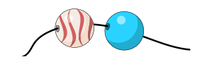
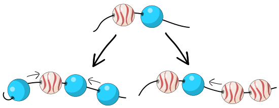

Monika macht Matrosenketten mit weiß-roten Wellenperlen und einfarbigen blauen Perlen. Sie beginnt immer mit einer Wellenperle links und einer blauen Perle rechts:

Dann verlängert sie die Matrosenkette mehrmals. Jedesmal fügt sie

- entweder an beiden Enden der Schnur jeweils eine blaue Perle hinzu
- oder zwei Wellenperlen am rechten Ende der Schnur hinzu.

**Welche dieser Ketten ist keine von Monikas Matrosenketten?**
