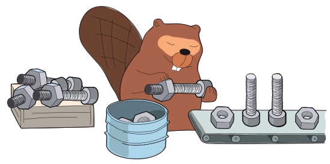

Ben steht am Fließband und verarbeitet Bauteile: Muttern und Schrauben.

Ben geht strikt nach folgendem Verfahren vor:

- Ben nimmt das nächste Bauteil vom Fließband herunter.
- Wenn Ben eine Mutter vom Fließband genommen hat, legt er sie in den Eimer.
- Wenn Ben eine Schraube vom Fließband genommen hat, nimmt er eine Mutter aus dem Eimer, schraubt sie auf die Schraube und legt das fertige Teil in den Kasten.

Bei diesem Verfahren können zwei Fehler auftreten:

1. Ben nimmt eine Schraube vom Fließband, aber es ist keine Mutter im Eimer, die er aufschrauben könnte.
2. Ben hat alle Bauteile vom Fließband verarbeitet, aber es sind immer noch Muttern im Eimer.

Der Eimer für die Muttern ist ausreichend groß und zu Beginn leer.

**Welche Folge von Muttern und Schrauben kann Ben ohne Fehler von links nach rechts verarbeiten?**
