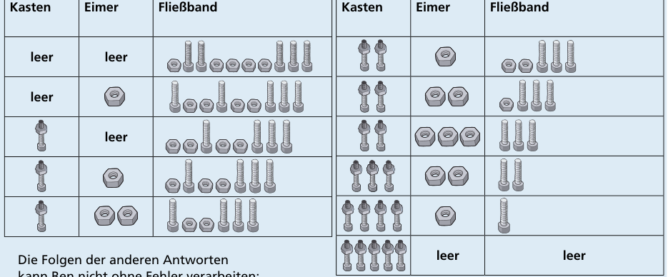

Antwort C ist richtig.

Die Tabelle zeigt für die Bauteilfolge aus Antwort C die Zustände des Kastens für die fertigen Teile, des Eimers für die Muttern und des Fließbands. Ben kann die gesamte Folge ohne Fehler verarbeiten.

Die Folgen der anderen Antworten kann Ben nicht ohne Fehler verarbeiten:

- Antwort A: Schon bei der zweiten Schraube tritt ein Fehler auf. Dann nimmt Ben eine Schraube, aber es ist keine Mutter im Eimer.
- Antwort B: Bei der fünften Schraube tritt ein Fehler auf. Ben hat bis dahin 4 Muttern auf 4 Schrauben geschraubt. Der Eimer ist also leer. Nun nimmt er die fünfte Schraube, aber es ist keine Mutter dafür im Eimer.
- Antwort D: Am Ende tritt ein Fehler auf. Nachdem Ben 4 Muttern auf 4 Schrauben geschraubt hat, bleiben 2 Muttern übrig.

## Das ist Informatik!

Ben verarbeitet Bauteile, die eins nach dem anderen von dem Fließband geliefert werden. Dabei verwendet er einen großen Eimer zum Zwischenspeichern der Muttern. Eine ähnliche Anordnung wird in der theoretischen Informatik als Modell für Algorithmen verwendet, die eine bestimmte Klasse von Problemen lösen können: Kellerautomaten. Ein Kellerautomat verarbeitet Daten (Zahlen oder Zeichen), die er nach und nach als Eingabe erhält. Er besitzt einen einzigen, unendlich großen Speicher: einen Keller. Im Unterschied zum Eimer in der Aufgabe haben die Elemente im Keller eine bestimmte Reihenfolge, und man kann aus einem Keller nur das Element herausnehmen, das man als letztes hineingegeben hat (nach dem Motto „last in first out“, kurz: LIFO).

Ein Kellerautomat kann verwendet werden, um eine kontextfreie Sprache zu erkennen. In der Informatik versteht man unter einer Sprache eine Menge von Zeichenketten, die nach bestimmten Regeln geformt worden sind. Ein einfacher Typ von Sprachen sind kontextfreie Sprachen. Ein Beispiel für eine kontextfreie Sprache sind alle wohlgeformten Klammerausdrücke. Bei einem wohlgeformten Klammerausdruck wird jede öffnende Klammer wieder geschlossen. Wohlgeformt sind z. B. ((( ))) und (()()). Nicht wohlgeformt sind dagegen (((() und ())(. Man kann sich die Muttern und Schrauben in der Aufgabe als öffnende und schließende Klammern vorstellen. Dann verarbeitet Ben eine Folge von Bauteilen auf dem Fließband nur dann ohne Fehler, wenn sie einen wohlgeformten Klammerausdruck darstellt. Das Prüfen von Klammerausdrücken ist eine wichtige Aufgabe eines Compilers, der Programmtexte in ausführbare Programme übersetzt. Denn in Programmtexten der meisten Programmiersprachen kommen geschachtelte Funktionsaufrufe und arithmetische Ausdrücke mit Klammern vor.

Das LIFO-Prinzip kommt beim Informatik-Biber 2022 auch in der Aufgabe „Bonbon-Spender“ vor.
