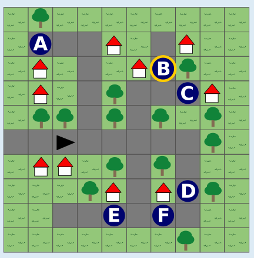

Tina befindet sich am Ende ihres Weges an Punkt B (dritte Zeile von oben, siebte Spalte).

Die richtige Antwort lässt sich schnell finden, wenn man schaut, zu welchen Punkten die Sensor-Infos der letzten Tabellenzeile (links Haus, vor Straße, rechts Baum) auf dem letzten Feld von Tinas Weg passen; das sind A, B und D.

Die Sensor-Infos der vorletzten Zeile (links Straße, vor Straße, rechts Baum) auf dem vorletzten Feld passen von diesen nur zu B.

Alternativ kann man versuchen, vom Startfeld aus einen Weg zu gehen, der mit den Sensor-Infos aus der Tabelle immer übereinstimmt. Der Weg zu Punkt B ist der einzige solche Weg.

## Das ist Informatik!

In dieser Biberaufgabe begegnen wir Roboter Tina. Roboter sind speziell ausgestattete Computer, die Informationen aus ihrer Umwelt mithilfe von Sensoren erfassen, diese Informationen automatisch (d. h. mit einem Programm) verarbeiten und aufgrund des Resultats eine Aktion in ihrer Umwelt mittels sogenannter Aktoren selbstständig ausführen.

Tinas Sensoren erfassen den Inhalt der Felder links, vorne und rechts. Damit sind die Sensoren schon recht leistungsstark, denn sie können nicht nur Bilder aufnehmen, sondern in diesen Bildern bestimmte Objekte erkennen, z. B. durch eine aufwändige Analyse der Bilddaten. Welche Aktoren Tina hat und welche Aktionen für diese Aktoren aus der Objekterkennung abgeleitet werden, wird in dieser Biberaufgabe nicht beschrieben. Tina hat aber offensichtlich Bewegungsaktoren, z. B. ein Fahrwerk und einen Motor, und ist in der Lage, sich damit in ihrer aktuellen Fahrtrichtung von einem Straßenfeld zum nächsten zu bewegen und ihre Richtung durch Drehen zu ändern.

Selbstfahrende Autos, an denen aktuell auch viele Informatikerinnen und Informatiker arbeiten, sind auch Roboter. Sie sind mit zahlreichen Sensoren ausgestattet, die unter anderem die Geschwindigkeit, die aktuelle Position und den Abstand vom Straßenrand messen sowie Objekte in der Umgebung erfassen. Zur Verarbeitung dieser Informationen werden oft sehr komplexe Algorithmen benötigt, die zum Beispiel Personen erkennen und sie von einem Straßenschild unterscheiden können. Zu den vielen Aktoren selbstfahrender Autos gehören Motor, Lenkung und Bremsen, die selbständig bzw. ohne menschliche Mitwirkung betätigt werden müssen.
