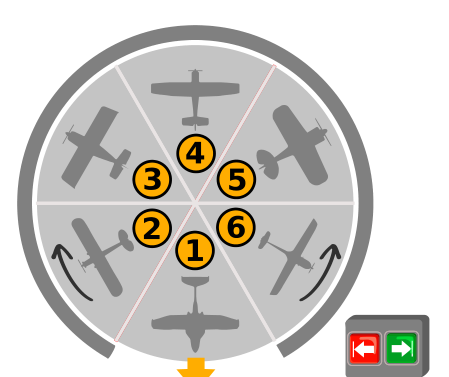

Auf dem Flugplatz von Beavertown parken sechs Flugzeuge in einem Hangar. Sie stehen auf einer Drehscheibe, in sechs Parkpositionen.

Außen gibt es zwei Pfeiltasten (rot nach links, grün nach rechts). Mit einem Tastendruck kann man die Drehscheibe um genau eine Parkposition nach links oder rechts drehen.

Morgens, wenn die Piloten ihre Flugzeuge abholen, ist die Parkposition 1 immer beim Hangartor, und das Flugzeug darauf kann herausrollen. Im besten Fall müssen die Pfeiltasten dann noch fünfmal gedrückt werden, damit auch alle weiteren Flugzeuge herausrollen können. Wenn beispielsweise die Piloten in der Reihenfolge 1, 6, 5, 4, 3, 2 auf die Parkpositionen zugreifen wollen, genügt es, die Taste „nach links“ fünfmal zu drücken.

Aber was ist der schlechteste Fall? Bei welcher Reihenfolge müssen die Tasten am häufigsten gedrückt werden? Natürlich drücken die Piloten die Tasten nur so oft wie unbedingt nötig, damit ihr Flugzeug herausrollen kann.

**Gib ein Beispiel für eine solche Reihenfolge.**
Ordne die Positionen 1 bis 6 in der Reihenfolge an, in der die Flugzeuge abgeholt werden.
