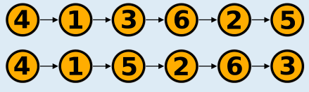
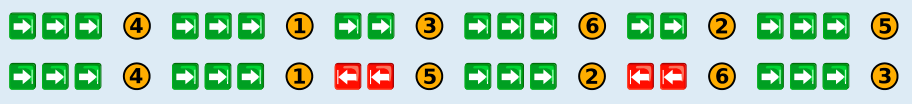

---
answers:
  - { p1: "4", p2: "1", p3: "3", p4: "6", p5: "2", p6: "5" }
  - { p1: "4", p2: "1", p3: "5", p4: "2", p5: "6", p6: "3" }
---
Es gibt zwei richtige Antworten: 4, 1, 3, 6, 2, 5 und 4, 1, 5, 2, 6, 3.

Es erfordert maximal häufiges Tastendrücken, wenn man immer auf die Parkposition zugreifen will, auf der noch ein Flugzeug steht und die davon die größte Entfernung von der Position hat, die gerade beim Hangartor ist. Dieser Strategie kann man auf zwei Weisen folgen (drei Tastendrücke nach rechts und dann das Flugzeug an Position 4 auszuparken, wird in der Grafik als „→ → → 4“ dargestellt):

In beiden Fällen müssen die Tasten 16-mal gedrückt werden.

Es ist nicht möglich, dass die Tasten häufiger als 16-mal gedrückt werden müssen: Nur bei den ersten beiden Zugriffen können Tasten dreimal gedrückt werden müssen (um zuerst auf Position 4 und dann auf Position 1 zuzugreifen). Bei den nächsten vier Zugriffen können sich höchstens zweimal und dreimal Drücken abwechseln.

## Das ist Informatik!

Der Rundhangar hat den Vorteil, dass Flugzeuge darin sehr platzsparend geparkt werden können. Das Abholen kann dafür aber länger dauern als bei einem gewöhnlichen Hangar. Da stellt sich die Frage, unter welchen Bedingungen ein Rundhangar für einen Flughafen vorteilhaft sein kann.

Die Informatik beschäftigt sich mit ähnlichen Fragen. Computer speichern zwar Daten statt Flugzeuge, aber auch bei einer Datenstruktur kann es passieren, dass sie besonders platzsparend ist, aber dafür der Zugriff auf die Daten länger dauert. Wenn die Effizienz einer Informatik-Methode zu bewerten ist, kann es also zu Abwägungen zwischen verschiedenen Effizienzkriterien – wie Speicherverbrauch und Laufzeit – kommen. Auch in der Informatik spricht man dann von einem Trade-Off.

Diese Biberaufgabe beschäftigt sich mit der Laufzeit des „Speicherzugriffs“ beim Rundhangar. Bei der Laufzeitanalyse spielt der worst case, also der schlechteste Fall, eine besondere Rolle. Man möchte ja auf alles vorbereitet sein, nicht nur auf den besonders angenehmen best case. Deshalb werden Algorithmen grundsätzlich nach ihrem worst case klassifiziert. Der kann aber eine besonders unrealistische Ausnahme darstellen. Ein realistisches Bild der Laufzeit ergibt sich oft erst, wenn man zusätzlich überlegt, wie gut ein Algorithmus mit den wahrscheinlich auftretenden Daten funktioniert, dem average case.
