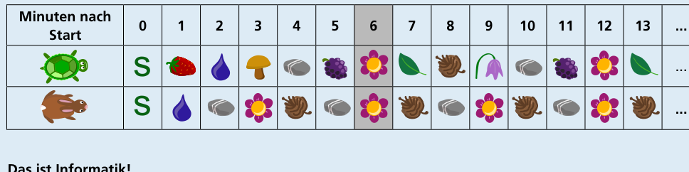
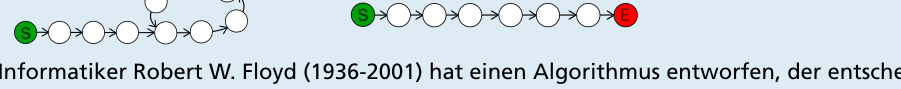

Schildkröte und Hase treffen sich zum ersten Mal auf dem Feld mit der Blume wieder. Man kann das leicht mit 2 Fingern nachvollziehen.

Die Tabelle zeigt im Minutentakt, auf welchen Feldern Schildkröte und Hase sich befinden. Nach 6 Minuten treffen sie sich zum ersten Mal wieder:

## Das ist Informatik!

Der Wettlauf zwischen Schildkröte und Hase findet auf einer besonderen Laufbahn statt. Sie besteht aus einzelnen Feldern sowie aus Pfeilen, die jeweils von einem Feld zu höchstens einem nächsten Feld zeigen. Die Laufbahn mündet in einen Kreis aus sechs Feldern, in dem die Läufer endlos laufen können. Schildkröte und Hase können sich in dieser Aufgabe nur begegnen, weil es diesen Kreis gibt.

In der Informatik bezeichnet man eine Struktur, wie sie durch die Laufbahn beschrieben ist, als Liste. Gibt es in der Liste einen Kreis, wie in dieser Biberaufgabe, bezeichnet man diesen als Zyklus. Es gibt Listen mit einem Zyklus (im Bild links) und Listen ohne Zyklus. Hat eine Liste keinen Zyklus, dann besteht die Liste aus einer Kette von Knoten mit einem Endfeld, von dem kein Pfeil ausgeht (im Bild rechts).

Der berühmte Informatiker Robert W. Floyd (1936–2001) hat einen Algorithmus entworfen, der entscheiden kann, ob eine Liste einen Zyklus hat oder nicht. Er lässt genau wie in dieser Biberaufgabe den Hasen und die Schildkröte am Startfeld loslaufen, den Hasen mit der doppelten Geschwindigkeit der Schildkröte. Wenn Schildkröte und Hase gleichzeitig auf einem Feld ankommen, gibt es einen Zyklus. In dem Moment, in dem der Hase keinen weiteren Zug mehr machen kann, hat er das Endfeld oder das Feld davor erreicht, und es ist kein Zyklus vorhanden.
