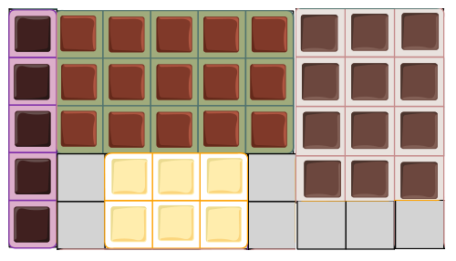

Jeder Kunde einer Schokoladenfabrik soll als Werbung vier Tafeln Schokolade bekommen. Die Tafeln sind unterschiedlich groß (1 × 5, 2 × 3, 3 × 4 und 3 × 5 Stücke), aber ihre Stücke sind alle quadratisch und gleich groß.

Die vier Tafeln müssen nebeneinander in eine Schachtel. In der Schachtel soll so wenig Platz frei bleiben wie möglich. Wenn die Tafeln zum Beispiel so gelegt werden, passen sie in eine Schachtel für 5 × 9 Stücke, mit freiem Platz für 7 Stücke.

**Lege die Tafeln so, dass sie in eine Schachtel mit möglichst wenig freiem Platz passen.** Die gestrichelte Linie zeigt die kleinste Schachtel um deine Tafeln.
