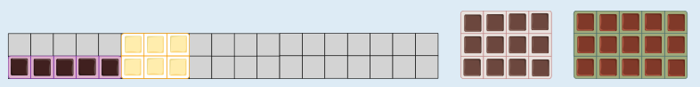
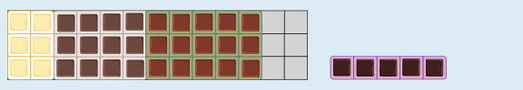
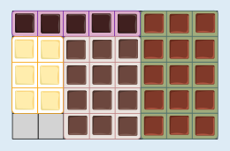

Die kleinste mögliche Schachtel hat Platz für 40 Stücke (zum Beispiel 4 × 10 oder 5 × 8); es bleibt also Platz für nur 2 Stücke frei.

Insgesamt sollen 12 + 15 + 6 + 5 = 38 Schokoladenstücke in die Schachtel. Eine Schachtel, in die 38 einzelne Stücke ohne freien Platz gelegt werden können, müsste entweder die Größe 1 × 38 oder 2 × 19 haben; 2 und 19 sind die einzigen Teiler von 38. Die beiden Tafeln mit den Größen 3 × 4 und 3 × 5 würden in keine dieser Schachteln passen.

Eine Schachtel für 39 Stücke (also mit freiem Platz für genau ein weiteres Stück) hat entweder die Größe 1 × 39 oder 3 × 13. In die Schachtel der Größe 1 × 39 passt nur die Tafel 1 × 5. In die Schachtel der Größe 3 × 13 passen die Tafeln 3 × 5, 3 × 4, 3 × 2, die Tafel 1 × 5 passt aber nicht in den verbleibenden freien Platz der Größe 3 × 2.

Eine Schachtel für 40 Stücke wiederum kann folgende Größen haben: 1 × 40, 2 × 20, 4 × 10, 5 × 8. In die Schachteln der Größe 1 × 40 und 2 × 20 passen nicht alle Tafeln. In die beiden anderen Schachteln passen alle vier Tafeln, z. B. so:

Man kann die Tafeln noch zu einigen anderen Anordnungen legen, die in eine Schachtel für 40 Stücke passen. Platzsparender als mit freiem Platz für 2 Stücke können die vier Tafeln aber nicht gepackt werden.

## Das ist Informatik!

In dieser Biberaufgabe sollen Rechtecke so angeordnet werden, dass das umschließende Rechteck die minimale Fläche hat. Dieses Problem ist in der Informatik auch als „rectangle packing“ bekannt, eines von vielen so genannten Verpackungsproblemen. Für wenige Rechtecke lässt sich relativ einfach die optimale Lösung finden (hier die kleinstmögliche Schachtel). Bei größeren Stückzahlen ist es notwendig, den Prozess zu automatisieren; es wird also ein Algorithmus benötigt, der als Computerprogramm realisiert werden kann. Leider ist „rectangle packing“, wie viele andere Verpackungsprobleme auch, NP-vollständig. Das bedeutet, dass es für das Problem sehr wahrscheinlich keinen effizienten Algorithmus gibt, der optimale Lösungen findet. In der Informatik werden für NP-vollständige Probleme deshalb effiziente Algorithmen entwickelt, die zwar nicht garantiert optimale, aber nachweisbar gute Lösungen finden können.

Unter anderem für Logistikunternehmen sind effiziente Lösungsansätze für Probleme solcher Art von großer Bedeutung, z. B. zum Einlagern in Hochregalen, fürs platzsparende Verpacken von Waren, oder zur Verteilung von Waren auf Container. Außerdem können scheinbar andersartige Probleme als Verpackungsprobleme beschrieben werden. Ein Arbeitsprozess, den N Arbeitskräfte in M Stunden bewältigen können, kann zum Beispiel als N × M Rechteck dargestellt werden. Mehrere Prozesse kann man also mit möglichst geringem Aufwand an Personen und Zeit bewältigen, wenn man für die entsprechenden Rechtecke das „rectangle packing“ Problem optimal löst.
