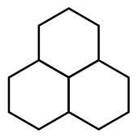

Sami legt weiße Sechsecke aneinander. Dann malt er sie aus, mit drei verschiedenen Farben (hier grün mit Quadrat, gelb mit Punkt und blau mit Stern). Immer wenn drei Sechsecke genau so zusammen liegen (zwei unten und eines oben in der Mitte), müssen sie am Ende …

- alle drei die gleiche Farbe **oder**
- alle drei verschiedene Farben haben.

Das gefällt Sami! Sami hat viele Sechsecke aneinander gelegt und schon einige ausgemalt.

**Male alle übrigen Sechsecke aus, so wie es Sami gefällt.**
