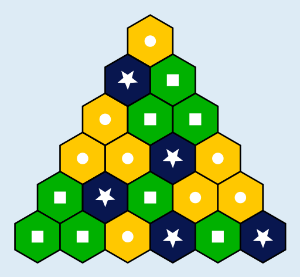

---
answer:
  - [2]
  - [3, 1]
  - [2, 1, 1]
  - [2, 2, 3, 2]
  - [1, 3, 1, 2, 2]
  - [1, 1, 2, 3, 1, 3]
---

Sobald zwei Sechsecke ausgemalt sind, die in der Sechseck-Pyramide nebeneinander liegen, steht die Farbe für das Sechseck darüber fest: Haben beide die gleiche Farbe, bekommt das Sechseck darüber ebenfalls diese Farbe. Haben beide verschiedene Farben, bekommt das Sechseck darüber die dritte Farbe. So muss zum Beispiel das unterste zu Beginn weiße Sechseck die Farbe Blau bekommen.

So kann man die übrigen Sechsecke reihenweise, von unten nach oben, nacheinander ausmalen, so wie es Sami gefällt.

## Das ist Informatik!

Wie löst man diese Biberaufgabe? Wenn man ein Sechseck ausmalt, führt man eine Aktion aus. Um die richtige Aktion (mit der richtigen Farbe) auszuwählen, muss man sich die Sechsecke darunter anschauen und prüfen, welche Bedingung sie erfüllen: Haben sie die gleiche Farbe oder unterschiedliche Farben? Diese Prüfung, mit anschließender Aktion, wird wiederholt, nämlich für jedes noch weiße Sechseck, das über zwei bereits ausgemalten Sechsecken liegt.

Aktionen, Bedingungen, Wiederholungen: Das sind die Grundbausteine eines jeden Algorithmus, also eines präzise beschriebenen Verfahrens, das auch als Programm für einen Computer realisiert werden kann. Beim Lösen dieser Biberaufgabe hast du also einen Algorithmus erfunden. Das ist eine der wichtigsten Aufgaben von Informatikerinnen und Informatikern: Algorithmen zu erfinden oder bereits erfundene Algorithmen nutzen und in Programme für Computer umzusetzen, um Aufgaben und Probleme mit automatischer Informationsverarbeitung zu lösen.
