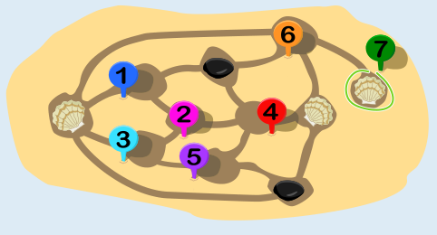
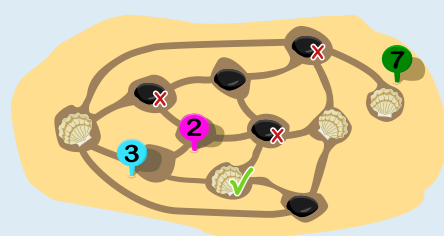
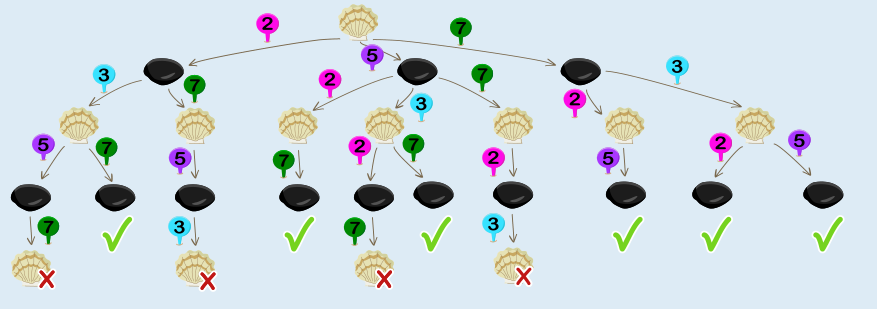

Ann muss ihre Muschel in die Mulde ganz rechts setzen (Mulde 7 in den Bildern).

Ann ist an der Reihe. Für sie kommen die Mulden 1, 3, 4 und 6 nicht in Frage, es bleiben also 2, 5 und 7.

Sie sieht, dass für Bob die Mulden 1, 4, 5 und 6 nicht in Frage kommen. Für ihn bleiben also 2, 3 und 7.

Wenn Ann die 7 spielt, kann Bob entweder 2 oder 3 spielen; in beiden Fällen kann Ann noch die 5 spielen und Bob verliert.

Wenn Ann beim vorgegebenen Spielstand die 2 spielen würde, könnte Bob als nächstes die 7 spielen. Danach müsste Ann die 5 spielen, Bob die 3, und dann hätte Ann verloren. Würde Ann die 5 spielen, könnte Bob die 7 spielen, Ann müsste die 2 spielen, Bob die 3, und wieder hätte Ann verloren. Übrigens könnte Bob auch nicht gewinnen, wenn er beim vorgegebenen Spielstand an der Reihe wäre und Ann alles richtig macht.

## Das ist Informatik!

Um die möglichen Spielzüge von Ann und Bob systematisch darzustellen, bietet sich ein sogenannter Spielbaum an:

In diesem Spielbaum lässt sich ablesen, mit welchem Zug Ann sich den Sieg sichern kann: Im rechten Ast, der damit beginnt, dass Ann die 7 spielt, sind nur Situationen erreichbar, in denen sie gewinnt. Die Informatik beschäftigt sich mit Algorithmen zur Auswertung solcher Spielbäume, u. a. in der kombinatorischen Spieltheorie. Computer mit ausreichender Rechenleistung können in Spielen wie Schach gegen Menschen antreten und gewinnen. Die Spieltheorie bietet im Allgemeinen aber auch für die Psychologie, die Wirtschaftswissenschaften und andere Fächer Modelle für komplexe Systeme, in denen „Spieler“ interagieren, etwa für das Kaufverhalten von Kunden bei Preisänderungen oder für die Routenwahl im Straßenverkehr.

Bei dem Spiel von Ann und Bob in dieser Biberaufgabe handelt es sich um eine Instanz von „COL“. Dieses Spiel für zwei Spieler wurde von Colin Vout eingeführt und spielt im bekannten Buch „On Numbers and Games“ (Erstpublikation 1976) des Mathematikers John Horton Conway (1937–2020) eine Rolle. Dahinter steckt ein Färbeproblem, so wie bei der Aufgabe „Ausmalbild“.
