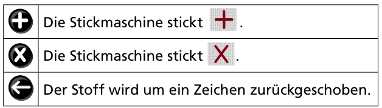

Lana besitzt eine programmierbare Stickmaschine.

Die Maschine kann diese zwei Zeichen sticken: ein Plus (**+**) oder ein Kreuz (**X**). Außerdem kann sie aus diesen Zeichen ein drittes Zeichen zusammensetzen, einen Stern (**✳**). Dazu muss der Stoff zwischen **X** und **+** (oder umgekehrt) um ein Zeichen zurückgeschoben werden.

Lana programmiert die Stickmaschine mit diesen drei Tasten:

Die Stickmaschine führt ein Programm so oft hintereinander aus, wie Lana will. So hat Lana dieses Muster

mit diesem Programm erstellt:

Mit welchem Programm hat Lana nun dieses Muster erstellt?

**Welches Programm passt?**
