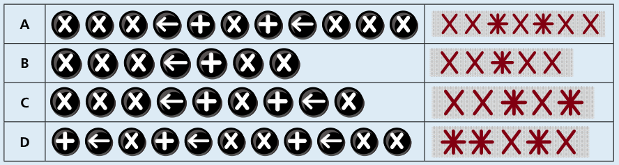

Antwort C ist richtig.

Das Muster wird durch eine (unbekannte) Anzahl von Ausführungen des gesuchten Programms erstellt. Es enthält also mehrfach hintereinander ein immer gleiches Teil-Muster, das durch einmalige Ausführung des Programms entsteht. Zunächst müssen wir also dieses sich wiederholende Teil-Muster erkennen; das ist dieses hier:

Welches Programm erzeugt nun dieses Muster bei einmaliger Ausführung? Wir können zum einen versuchen, aus dem Muster auf das Programm zu schließen. Wir wissen, dass das Zeichen X durch die X-Taste gestickt wird. Das Zeichen Stern wiederum kann durch zwei verschiedene Tastenfolgen gestickt werden, nämlich X, Pfeil, Plus oder Plus, Pfeil, X. Das gesuchte Programm hat also die Form X, X, ?, X, ?, wobei an der Stelle der Fragezeichen je eine der beiden Tastenfolgen für den Stern stehen kann. Nur das Programm in Antwort C hat diese Form.

Zum anderen können wir für jedes Programm feststellen, welches Muster es bei einmaliger Ausführung erzeugt. Hier ist eine Tabelle; das obige Teil-Muster entsteht durch Programm C.

## Das ist Informatik!

Die Stickmaschine kennt drei verschiedene Anweisungen. Sie kann eine beliebige, aber endliche Folge dieser Anweisungen ausführen und so ihre Muster erzeugen. Außerdem kann sie – auf Anstoß des Benutzers oder der Benutzerin – die Ausführung der Anweisungsfolge wiederholen. Die Anweisungsfolge wird als Programm bezeichnet.

Damit funktioniert die Stickmaschine ganz ähnlich wie ein Computer. Auch Computer kennen eine Reihe von Anweisungen, meist aber deutlich mehr als drei. Auch Computerprogramme bestehen aus Folgen dieser Anweisungen. Allerdings ist es für Menschen recht schwierig, mit Hilfe der Anweisungen, die ein Computer direkt ausführen kann (in der Informatik auch Maschinenanweisungen genannt), ein Programm zu schreiben. Deshalb gibt es Programmiersprachen mit anderen Anweisungen, die Menschen besser verstehen können. Damit ein Computer ein Programm ausführen kann, das in einer solchen höheren Programmiersprache geschrieben ist, müssen die Anweisungen der Programmiersprache in Maschinenanweisungen übersetzt werden.

Im Gegensatz zu den Programmen der Stickmaschine gibt es in allen höheren Programmiersprachen für Computer nicht nur einfache Anweisungen und Anweisungsfolgen, sondern insbesondere bedingte Anweisungen und Wiederholungsanweisungen. Sie sorgen dafür, dass Teile des Programms abhängig von Bedingungen ausgeführt bzw. wiederholt ausgeführt werden. Erst diese besonderen Anweisungen verhelfen Programmiersprachen und damit auch Computern zu ihrer besonderen Leistungsfähigkeit.
