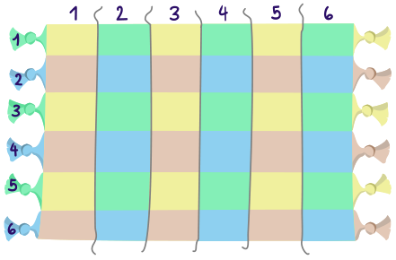

Hale ist eine türkische Künstlerin. Sie gestaltet ein Teppichmuster. Der Teppich hat Felder, in sechs Zeilen und sechs Spalten. Für jedes Feld gibt es die Nummer der Zeile und die der Spalte.

Hales Angestellte sollen in jedes Feld ein Symbol setzen. Hale hat ihnen dazu diese Anleitung gegeben:

**Wie wird der Teppich aussehen?**
